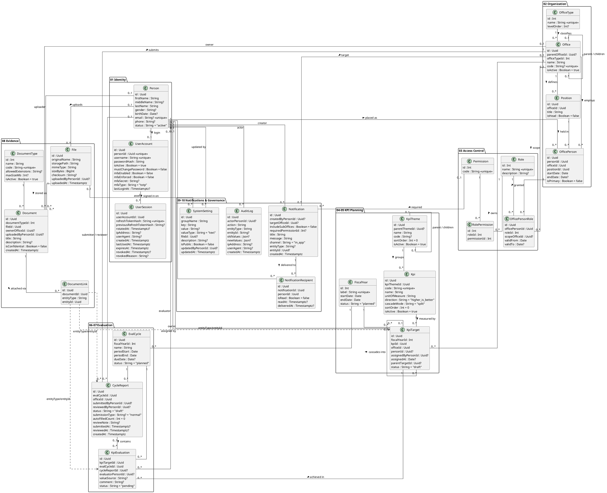

# Class Diagram - AMU-KPI-Monitoring-System

## Overview

Class diagram of the **Arba Minch University (AMU) KPI Monitoring System**, mapped one-to-one to
[Backend/prisma/schema.prisma](../Backend/prisma/schema.prisma) (26 models, PostgreSQL) and to the ten modules in
[MODULES_SPECIFICATION.html](../MODULES_SPECIFICATION.html). Table names (snake_case) are shown in brackets.

| Module | Models |
|---|---|
| 01 Identity & Authentication | `Person`, `UserAccount`, `UserSession` |
| 02 Organizational Hierarchy | `OfficeType`, `Office`, `Position`, `OfficePerson` |
| 03 Scoped Access Control | `Role`, `Permission`, `RolePermission`, `OfficePersonRole` |
| 04 Strategic KPI Catalog | `FiscalYear`, `KpiTheme`, `Kpi` |
| 05 Target Cascading | `KpiTarget` |
| 06 Evaluation Cycles | `EvalCycle`, `CycleReport` |
| 07 Performance Scoring | `KpiEvaluation` |
| 08 Evidence & Documents | `File`, `DocumentType`, `Document`, `DocumentLink` |
| 09 Notifications | `Notification`, `NotificationRecipient` |
| 10 System Governance | `SystemSetting`, `AuditLog` |

---

## 1. Domain Description

### Identity (Module 01)
- **Person** `[person]` — the human being (faculty, staff, management) with demographic and contact data. Every other
  module references a `Person`, never a login account.
- **UserAccount** `[user_account]` — optional 1:1 login credentials for a Person: username, bcrypt hash, first-login
  password change flag and TOTP MFA settings (`mfaEnabled`, `mfaEnforced`, `mfaSecret`). Deleting a Person cascades to it.
- **UserSession** `[user_session]` — one row per logged-in device/browser, so an account can have many concurrent
  sessions. Access tokens carry the session id (`sid`) and stop working as soon as the session is revoked or expires.
  Only SHA-256 hashes of the rotating refresh token are stored; replaying an already-rotated token revokes the session.
  Tracks IP, user agent, created / last used / expiry times and why it was revoked.

### Organization (Module 02)
- **OfficeType** `[office_type]` — tier of the hierarchy (University = 1, College = 2, Department = 3 …) via `levelOrder`.
- **Office** `[office]` — node of the university tree; `parentOfficeId` self-reference forms the `OfficeTree`.
- **Position** `[position]` — job title defined inside an office (e.g. Dean, Lecturer); `isHead` marks the office head.
- **OfficePerson** `[office_person]` — placement of a Person in an Office + Position with tenure (`startDate`/`endDate`)
  and an `isPrimary` flag. A person may hold several placements.

### Access control (Module 03)
- **Role** `[role]` — named bundle of permissions (Super Admin, Dean, Strategy Officer …).
- **Permission** `[permission]` — atomic code such as `kpi:create`, `target:cascade`; `*` is the Super Admin wildcard.
  The catalog lives in `Backend/config/permissions.js`.
- **RolePermission** `[role_permission]` — M:N join between Role and Permission.
- **OfficePersonRole** `[office_person_role]` — grants a Role to a placement, optionally limited to `scopeOfficeId`
  (that office and its descendants; `null` = university-wide) and a validity window (`validFrom`/`validTo`).

### KPI planning (Modules 04–05)
- **FiscalYear** `[fiscal_year]` — planning year (e.g. "2018 E.C.") with status `planned | active | closed`.
- **KpiTheme** `[kpi_theme]` — strategic pillar; `parentThemeId` self-reference forms the `ThemeTree`.
- **Kpi** `[kpi]` — master indicator: unit, `direction` (`higher_is_better | lower_is_better`), `cascadeMode`
  (`split | replicate | aggregate`) and `maxOverAllocationPercent` for cascading.
- **KpiTarget** `[kpi_target]` — target value for a KPI, office (and optionally a person) in a fiscal year.
  `parentTargetId` self-reference forms the `TargetTree`: a university target is cascaded into college, department
  and individual targets. Two Person relations: owner (`TargetOwner`) and assigner (`TargetAssigner`).

### Evaluation (Modules 06–07)
- **EvalCycle** `[eval_cycle]` — reporting window inside a fiscal year (Q1, Mid-Year, Annual) with status
  `planned | open | in_review | closed`.
- **CycleReport** `[cycle_report]` — one report dossier per office per cycle (`@@unique([evalCycleId, officeId])`);
  submitted and reviewed by Persons.
- **KpiEvaluation** `[kpi_evaluation]` — achievement for one target in one cycle (`@@unique([kpiTargetId, evalCycleId])`):
  `reportedValue`, verified `actualValue`, computed `score`, optional link to the CycleReport and evaluator.

### Evidence (Module 08)
- **File** `[file]` — stored binary: path, MIME type, size, checksum, uploader.
- **DocumentType** `[document_type]` — evidence category with allowed extensions and max size.
- **Document** `[document]` — business document wrapping a File (title, owner office, confidentiality).
- **DocumentLink** `[document_link]` — polymorphic attachment of a Document to any entity by
  (`entityType`, `entityId`), e.g. `kpi_evaluation`, `cycle_report`, `kpi_target`.

### Notifications & governance (Modules 09–10)
- **Notification** `[notification]` — broadcast to a target office (optionally `includeSubOffices`) and/or the holders
  of a `requiredPermission`; may reference an entity.
- **NotificationRecipient** `[notification_recipient]` — per-person delivery and read receipt.
- **SystemSetting** `[system_setting]` — key/value configuration grouped by `groupName` (`@@unique([groupName, key])`),
  optional File (e.g. logo), `isPublic` flag.
- **AuditLog** `[audit_log]` — immutable record of who changed what (`oldValues`/`newValues` JSON), from which IP/agent.

---

## 2. PlantUML Class Diagram

---

## 3. Key Constraints

| Model | Constraint | Meaning |
|---|---|---|
| UserAccount | `personId` unique, `onDelete: Cascade` | At most one login per person; removed with the person |
| UserSession | `refreshTokenHash` unique, `onDelete: Cascade` | Each refresh token maps to one session; sessions are removed with the account |
| RolePermission | `@@unique([roleId, permissionId])` | A permission is granted to a role once |
| OfficePersonRole | `@@unique([officePersonId, roleId, scopeOfficeId, validFrom])` | No duplicate scoped grants |
| CycleReport | `@@unique([evalCycleId, officeId])` | One report dossier per office per cycle |
| KpiEvaluation | `@@unique([kpiTargetId, evalCycleId])` | One achievement entry per target per cycle |
| DocumentLink | `@@unique([documentId, entityType, entityId])` | A document is linked to an entity once |
| SystemSetting | `@@unique([groupName, key])` | Keys are unique within a group |
| NotificationRecipient | `@@unique([notificationId, personId])` | One receipt per person per notification |
