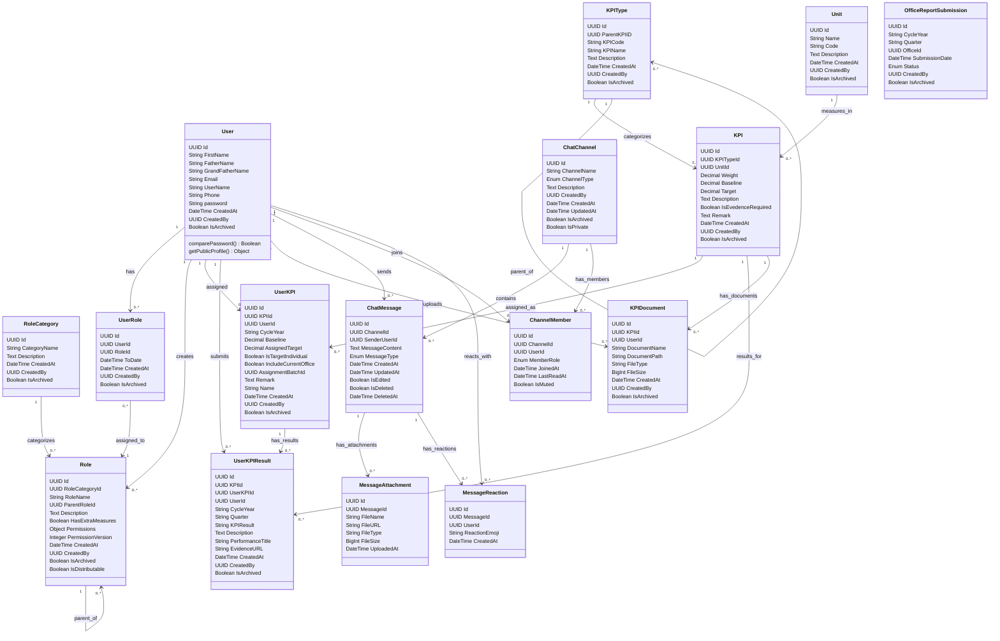

# Class Diagram - AMU-KPI-Monitoring-System

## Overview

This document contains the detailed class diagram for the AMU-KPI-Monitoring-System, including the new Chat System module. The diagram shows all entity classes, their attributes, relationships, and cardinality.

---

## 1. Class Structure Description

### Core User & Authentication Module

- **User**: Represents system users with authentication and profile information
- **UserRole**: Maps users to roles with date-based activation/archiving
- **Role**: Defines roles with hierarchical parent-child relationships and permissions
- **RoleCategory**: Categorizes roles (Admin, Faculty, Staff, etc.)

### KPI Management Module

- **KPI**: Represents Key Performance Indicators with targets and baselines
- **KPIType**: Hierarchical categorization of KPIs
- **Unit**: Measurement units for KPIs (%, Count, Amount, etc.)
- **UserKPI**: Assignment of KPIs to users with custom baselines/targets
- **UserKPIResult**: Performance results submitted by users

### Supporting Entities

- **KPIDocument**: Stores documents related to KPIs
- **OfficeReportSubmission**: Tracks official office-level KPI submissions

### Chat System Module (NEW)

- **ChatChannel**: Represents communication channels (Direct/Group)
- **ChatMessage**: Individual messages with attachments support
- **ChannelMember**: Maps users to channels with role definitions
- **MessageAttachment**: File attachments in messages
- **MessageReaction**: Emoji/reaction system for messages

---

## 2. Detailed Attributes by Class

### User

- `Id: UUID` (PK)
- `FirstName: String`
- `FatherName: String`
- `GrandFatherName: String`
- `Email: String` (Unique)
- `UserName: String` (Unique)
- `Phone: String`
- `password: String` (Hashed)
- `CreatedAt: DateTime`
- `CreatedBy: UUID` (FK -> User)
- `IsArchived: Boolean`

### Role

- `Id: UUID` (PK)
- `RoleCategoryId: UUID` (FK -> RoleCategory)
- `RoleName: String`
- `ParentRoleId: UUID` (Self-referencing FK)
- `Description: Text`
- `HasExtraMeasures: Boolean`
- `Permissions: JSONB`
- `PermissionVersion: Integer`
- `CreatedAt: DateTime`
- `CreatedBy: UUID` (FK -> User)
- `IsArchived: Boolean`
- `IsDistributable: Boolean`

### RoleCategory

- `Id: UUID` (PK)
- `CategoryName: String` (Unique)
- `Description: Text`
- `CreatedAt: DateTime`
- `CreatedBy: UUID` (FK -> User)
- `IsArchived: Boolean`

### UserRole

- `Id: UUID` (PK)
- `UserId: UUID` (FK -> User)
- `RoleId: UUID` (FK -> Role)
- `ToDate: DateTime`
- `CreatedAt: DateTime`
- `CreatedBy: UUID` (FK -> User)
- `IsArchived: Boolean`

### KPI

- `Id: UUID` (PK)
- `KPITypeId: UUID` (FK -> KPIType)
- `UnitId: UUID` (FK -> Unit)
- `Weight: Decimal` (0-100)
- `Baseline: Decimal`
- `Target: Decimal`
- `Description: Text`
- `IsEvedenceRequired: Boolean`
- `Remark: Text`
- `CreatedAt: DateTime`
- `CreatedBy: UUID` (FK -> User)
- `IsArchived: Boolean`

### KPIType

- `Id: UUID` (PK)
- `ParentKPIID: UUID` (Self-referencing FK)
- `KPICode: String`
- `KPIName: String`
- `Description: Text`
- `CreatedAt: DateTime`
- `CreatedBy: UUID` (FK -> User)
- `IsArchived: Boolean`

### Unit

- `Id: UUID` (PK)
- `Name: String`
- `Code: String` (Unique)
- `Description: Text`
- `CreatedAt: DateTime`
- `CreatedBy: UUID` (FK -> User)
- `IsArchived: Boolean`

### UserKPI

- `Id: UUID` (PK)
- `KPIId: UUID` (FK -> KPI)
- `UserId: UUID` (FK -> User)
- `CycleYear: String`
- `Baseline: Decimal`
- `AssignedTarget: Decimal`
- `IsTargetIndividual: Boolean`
- `IncludeCurrentOffice: Boolean`
- `AssignmentBatchId: UUID`
- `Remark: Text`
- `Name: String`
- `CreatedAt: DateTime`
- `CreatedBy: UUID` (FK -> User)
- `IsArchived: Boolean`

### UserKPIResult

- `Id: UUID` (PK)
- `KPIId: UUID` (FK -> KPI)
- `UserKPIId: UUID` (FK -> UserKPI)
- `UserId: UUID` (FK -> User)
- `CycleYear: String`
- `Quarter: String`
- `KPIResult: String`
- `Description: Text`
- `PerformanceTitle: String`
- `EvidenceURL: String`
- `CreatedAt: DateTime`
- `CreatedBy: UUID` (FK -> User)
- `IsArchived: Boolean`

### KPIDocument

- `Id: UUID` (PK)
- `KPIId: UUID` (FK -> KPI)
- `UserId: UUID` (FK -> User)
- `DocumentName: String`
- `DocumentPath: String`
- `FileType: String`
- `FileSize: BigInt`
- `CreatedAt: DateTime`
- `CreatedBy: UUID` (FK -> User)
- `IsArchived: Boolean`

### OfficeReportSubmission

- `Id: UUID` (PK)
- `CycleYear: String`
- `Quarter: String`
- `OfficeId: UUID`
- `SubmissionDate: DateTime`
- `Status: Enum` (Submitted, Reviewed, Approved, Rejected)
- `CreatedBy: UUID` (FK -> User)
- `IsArchived: Boolean`

### ChatChannel (NEW)

- `Id: UUID` (PK)
- `ChannelName: String`
- `ChannelType: Enum` (Direct, Group, Announcement)
- `Description: Text`
- `CreatedBy: UUID` (FK -> User)
- `CreatedAt: DateTime`
- `UpdatedAt: DateTime`
- `IsArchived: Boolean`
- `IsPrivate: Boolean`

### ChatMessage (NEW)

- `Id: UUID` (PK)
- `ChannelId: UUID` (FK -> ChatChannel)
- `SenderUserId: UUID` (FK -> User)
- `MessageContent: Text`
- `MessageType: Enum` (Text, Image, File, System)
- `CreatedAt: DateTime`
- `UpdatedAt: DateTime`
- `IsEdited: Boolean`
- `IsDeleted: Boolean`
- `DeletedAt: DateTime`

### ChannelMember (NEW)

- `Id: UUID` (PK)
- `ChannelId: UUID` (FK -> ChatChannel)
- `UserId: UUID` (FK -> User)
- `MemberRole: Enum` (Owner, Admin, Moderator, Member)
- `JoinedAt: DateTime`
- `LastReadAt: DateTime`
- `IsMuted: Boolean`

### MessageAttachment (NEW)

- `Id: UUID` (PK)
- `MessageId: UUID` (FK -> ChatMessage)
- `FileName: String`
- `FileURL: String`
- `FileType: String`
- `FileSize: BigInt`
- `UploadedAt: DateTime`

### MessageReaction (NEW)

- `Id: UUID` (PK)
- `MessageId: UUID` (FK -> ChatMessage)
- `UserId: UUID` (FK -> User)
- `ReactionEmoji: String`
- `CreatedAt: DateTime`

---

## 3. PlantUML Class Diagram Code

```plantuml
@startuml AMU-KPI-System-ClassDiagram

' Define color scheme
skinparam classBackgroundColor #E1F5FE
skinparam classBorderColor #0277BD
skinparam classArrowColor #0277BD
skinparam backgroundColor #FAFAFA

' ============================================================
' USER & AUTHENTICATION MODULE
' ============================================================

class User {
  - Id: UUID <<PK>>
  - FirstName: String
  - FatherName: String
  - GrandFatherName: String
  - Email: String <<Unique>>
  - UserName: String <<Unique>>
  - Phone: String
  - password: String
  - CreatedAt: DateTime
  - CreatedBy: UUID <<FK>>
  - IsArchived: Boolean
  --
  + comparePassword(): Boolean
  + getPublicProfile(): Object
}

class Role {
  - Id: UUID <<PK>>
  - RoleCategoryId: UUID <<FK>>
  - RoleName: String
  - ParentRoleId: UUID <<Self FK>>
  - Description: Text
  - HasExtraMeasures: Boolean
  - Permissions: JSONB
  - PermissionVersion: Integer
  - CreatedAt: DateTime
  - CreatedBy: UUID <<FK>>
  - IsArchived: Boolean
  - IsDistributable: Boolean
}

class RoleCategory {
  - Id: UUID <<PK>>
  - CategoryName: String <<Unique>>
  - Description: Text
  - CreatedAt: DateTime
  - CreatedBy: UUID <<FK>>
  - IsArchived: Boolean
}

class UserRole {
  - Id: UUID <<PK>>
  - UserId: UUID <<FK>>
  - RoleId: UUID <<FK>>
  - ToDate: DateTime
  - CreatedAt: DateTime
  - CreatedBy: UUID <<FK>>
  - IsArchived: Boolean
}

' ============================================================
' KPI MANAGEMENT MODULE
' ============================================================

class KPI {
  - Id: UUID <<PK>>
  - KPITypeId: UUID <<FK>>
  - UnitId: UUID <<FK>>
  - Weight: Decimal (0-100)
  - Baseline: Decimal
  - Target: Decimal
  - Description: Text
  - IsEvedenceRequired: Boolean
  - Remark: Text
  - CreatedAt: DateTime
  - CreatedBy: UUID <<FK>>
  - IsArchived: Boolean
}

class KPIType {
  - Id: UUID <<PK>>
  - ParentKPIID: UUID <<Self FK>>
  - KPICode: String
  - KPIName: String
  - Description: Text
  - CreatedAt: DateTime
  - CreatedBy: UUID <<FK>>
  - IsArchived: Boolean
}

class Unit {
  - Id: UUID <<PK>>
  - Name: String
  - Code: String <<Unique>>
  - Description: Text
  - CreatedAt: DateTime
  - CreatedBy: UUID <<FK>>
  - IsArchived: Boolean
}

class UserKPI {
  - Id: UUID <<PK>>
  - KPIId: UUID <<FK>>
  - UserId: UUID <<FK>>
  - CycleYear: String
  - Baseline: Decimal
  - AssignedTarget: Decimal
  - IsTargetIndividual: Boolean
  - IncludeCurrentOffice: Boolean
  - AssignmentBatchId: UUID
  - Remark: Text
  - Name: String
  - CreatedAt: DateTime
  - CreatedBy: UUID <<FK>>
  - IsArchived: Boolean
}

class UserKPIResult {
  - Id: UUID <<PK>>
  - KPIId: UUID <<FK>>
  - UserKPIId: UUID <<FK>>
  - UserId: UUID <<FK>>
  - CycleYear: String
  - Quarter: String
  - KPIResult: String
  - Description: Text
  - PerformanceTitle: String
  - EvidenceURL: String
  - CreatedAt: DateTime
  - CreatedBy: UUID <<FK>>
  - IsArchived: Boolean
}

class KPIDocument {
  - Id: UUID <<PK>>
  - KPIId: UUID <<FK>>
  - UserId: UUID <<FK>>
  - DocumentName: String
  - DocumentPath: String
  - FileType: String
  - FileSize: BigInt
  - CreatedAt: DateTime
  - CreatedBy: UUID <<FK>>
  - IsArchived: Boolean
}

class OfficeReportSubmission {
  - Id: UUID <<PK>>
  - CycleYear: String
  - Quarter: String
  - OfficeId: UUID
  - SubmissionDate: DateTime
  - Status: Enum {Submitted, Reviewed, Approved, Rejected}
  - CreatedBy: UUID <<FK>>
  - IsArchived: Boolean
}

' ============================================================
' CHAT SYSTEM MODULE
' ============================================================

class ChatChannel {
  - Id: UUID <<PK>>
  - ChannelName: String
  - ChannelType: Enum {Direct, Group, Announcement}
  - Description: Text
  - CreatedBy: UUID <<FK>>
  - CreatedAt: DateTime
  - UpdatedAt: DateTime
  - IsArchived: Boolean
  - IsPrivate: Boolean
}

class ChatMessage {
  - Id: UUID <<PK>>
  - ChannelId: UUID <<FK>>
  - SenderUserId: UUID <<FK>>
  - MessageContent: Text
  - MessageType: Enum {Text, Image, File, System}
  - CreatedAt: DateTime
  - UpdatedAt: DateTime
  - IsEdited: Boolean
  - IsDeleted: Boolean
  - DeletedAt: DateTime
}

class ChannelMember {
  - Id: UUID <<PK>>
  - ChannelId: UUID <<FK>>
  - UserId: UUID <<FK>>
  - MemberRole: Enum {Owner, Admin, Moderator, Member}
  - JoinedAt: DateTime
  - LastReadAt: DateTime
  - IsMuted: Boolean
}

class MessageAttachment {
  - Id: UUID <<PK>>
  - MessageId: UUID <<FK>>
  - FileName: String
  - FileURL: String
  - FileType: String
  - FileSize: BigInt
  - UploadedAt: DateTime
}

class MessageReaction {
  - Id: UUID <<PK>>
  - MessageId: UUID <<FK>>
  - UserId: UUID <<FK>>
  - ReactionEmoji: String
  - CreatedAt: DateTime
}

' ============================================================
' RELATIONSHIPS
' ============================================================

' User relationships
User "1" --o "0..*" UserRole : has
User "1" --o "0..*" Role : creates
User "1" --o "0..*" UserKPI : assigned
User "1" --o "0..*" UserKPIResult : submits
User "1" --o "0..*" KPIDocument : uploads
User "1" --o "0..*" ChatMessage : sends
User "1" --o "0..*" ChannelMember : participates_in
User "1" --o "0..*" MessageReaction : reacts_with

' Role relationships
Role "1" --o "0..*" UserRole : assigned_to
RoleCategory "1" --o "0..*" Role : categorizes
Role "1" --o "0..*" Role : has_child_roles

' KPI relationships
KPIType "1" --o "0..*" KPI : categorizes
Unit "1" --o "0..*" KPI : measures_in
KPI "1" --o "0..*" UserKPI : assigned_as
KPI "1" --o "0..*" UserKPIResult : results_for
KPI "1" --o "0..*" KPIDocument : has_documents
KPIType "1" --o "0..*" KPIType : has_child_types

' UserKPI relationships
UserKPI "1" --o "0..*" UserKPIResult : has_results

' Chat relationships
ChatChannel "1" --o "0..*" ChatMessage : contains
ChatChannel "1" --o "0..*" ChannelMember : has_members
ChatMessage "1" --o "0..*" MessageAttachment : has_attachments
ChatMessage "1" --o "0..*" MessageReaction : has_reactions

@enduml
```



---

## 4. Mermaid Class Diagram Code



---

## 5. Relationship Summary

### Cardinality Notation (PlantUML/Mermaid)

- `1` to `1`: One-to-one
- `1` to `0..*`: One-to-many (zero or more)
- `1` to `1..*`: One-to-many (one or more)

### Key Relationships

#### User & Authentication

| From     | To           | Cardinality | Description                       |
| -------- | ------------ | ----------- | --------------------------------- |
| User     | UserRole     | 1:M         | User has multiple roles           |
| UserRole | Role         | M:1         | Multiple users can have same role |
| Role     | RoleCategory | M:1         | Multiple roles in a category      |
| Role     | Role         | Self-ref    | Role hierarchy (parent-child)     |

#### KPI Management

| From    | To            | Cardinality | Description                     |
| ------- | ------------- | ----------- | ------------------------------- |
| KPI     | KPIType       | M:1         | Multiple KPIs of same type      |
| KPI     | Unit          | M:1         | Multiple KPIs use same unit     |
| KPI     | UserKPI       | 1:M         | KPI assigned to multiple users  |
| UserKPI | UserKPIResult | 1:M         | Multiple results per assignment |
| KPI     | UserKPIResult | 1:M         | Multiple results per KPI        |
| KPI     | KPIDocument   | 1:M         | Multiple documents per KPI      |

#### Chat System

| From        | To                | Cardinality | Description                    |
| ----------- | ----------------- | ----------- | ------------------------------ |
| ChatChannel | ChatMessage       | 1:M         | Multiple messages in channel   |
| ChatChannel | ChannelMember     | 1:M         | Multiple members in channel    |
| ChatMessage | MessageAttachment | 1:M         | Multiple files per message     |
| ChatMessage | MessageReaction   | 1:M         | Multiple reactions per message |
| User        | ChatMessage       | 1:M         | User sends multiple messages   |
| User        | ChannelMember     | 1:M         | User joins multiple channels   |

---

## 6. Module Dependencies

```
Authentication & Authorization Layer
        ↓
Role-Based Access Control
        ↓
KPI Management Layer
        ↓
Performance Tracking Layer
        ↓
Chat & Collaboration Layer (NEW)
```

---

## 7. Entity Relationships Diagram (Text)

```
USER ENTITY
├── Authenticates → Authentication System
├── Has Multiple → UserRole (Links to Role)
├── Creates/Manages → Role, RoleCategory
├── Receives → UserKPI (KPI Assignment)
├── Submits → UserKPIResult (Performance)
├── Uploads → KPIDocument (Evidence)
├── Sends → ChatMessage (Communication)
├── Joins → ChannelMember (Collaboration)
└── Reacts → MessageReaction (Feedback)

ROLE ENTITY
├── Belongs To → RoleCategory
├── Has Parent → Role (Self-referencing)
├── Has Children → Role (Multiple child roles)
├── Linked By → UserRole
└── Contains → Permissions (JSONB)

KPI ENTITY
├── Categorized By → KPIType
├── Measured In → Unit
├── Assigned As → UserKPI
├── Results Tracked → UserKPIResult
└── Documents → KPIDocument

USERKPI ENTITY
├── Links User To → KPI
├── Generates → UserKPIResult (Multiple)
└── Grouped By → AssignmentBatchId

CHATCHANNEL ENTITY
├── Contains → ChatMessage (Multiple)
├── Has Members → ChannelMember
└── Types: Direct, Group, Announcement

CHATMESSAGE ENTITY
├── Sent By → User
├── Contains → MessageAttachment (Multiple)
├── Reactions → MessageReaction (Multiple)
└── Types: Text, Image, File, System
```

---

## 8. Chat System Integration Points

### Direct Integration with Existing System

1. **User**: Chat messages and channel membership tied to User entity
2. **UserKPI**: KPI assignment discussions via chat channels
3. **UserKPIResult**: Result review/feedback via targeted channels
4. **Role-Based Chat**: Channels created per organizational role/hierarchy

### Chat Features

- **Direct Messages**: 1:1 communication between users
- **Group Channels**: Department/role-based discussion groups
- **Announcement Channels**: Broadcast important KPI updates
- **Thread Support**: Nested discussions on specific messages
- **Attachment Support**: Share KPI documents and evidence
- **Message Reactions**: Quick feedback with emoji reactions
- **Member Roles**: Owner, Admin, Moderator, Member permissions in channels

---

## 9. Design Patterns Used

### 1. **Soft Delete Pattern**

All entities have `IsArchived` boolean for non-destructive deletion, maintaining data integrity.

### 2. **Audit Trail Pattern**

All entities track `CreatedAt`, `CreatedBy`, and timestamps for compliance and tracking.

### 3. **UUID Primary Keys**

All entities use UUID for distributed system compatibility and security.

### 4. **Hierarchical Structure**

- Roles support parent-child relationships for organizational structure
- KPITypes support parent-child relationships for KPI categorization

### 5. **Composition Pattern**

- UserKPI composes KPI data with user-specific customizations (baseline, target)
- UserKPIResult composes result data with evidence support

### 6. **Role-Based Access Control (RBAC)**

- Permissions stored as JSONB in Role entity
- ChannelMember includes member roles for granular chat permissions

---

## 10. Implementation Notes

### Database Considerations

- All IDs are UUID for scalability and security
- Foreign keys maintain referential integrity
- JSONB used for flexible permission storage in Role entity
- Composite indexes recommended on (UserId, RoleId), (KPIId, UserId), (ChannelId, UserId)

### API Endpoints Implied by Classes

```
/api/users                          # User management
/api/roles                          # Role management
/api/user-roles                     # User role assignments
/api/kpis                           # KPI management
/api/user-kpis                      # KPI assignments
/api/user-kpi-results               # Performance results
/api/kpi-documents                  # KPI documents
/api/chat/channels                  # Chat channels
/api/chat/messages                  # Chat messages
/api/chat/channels/:id/members      # Channel members
/api/chat/messages/:id/attachments  # Message attachments
/api/chat/messages/:id/reactions    # Message reactions
```

### Security Considerations

- Passwords hashed with bcrypt before storage
- JWT tokens for session authentication
- Permission-based access control for all operations
- Chat channels can be private to restrict access
- Message deletion tracked but messages not permanently removed (soft delete)
