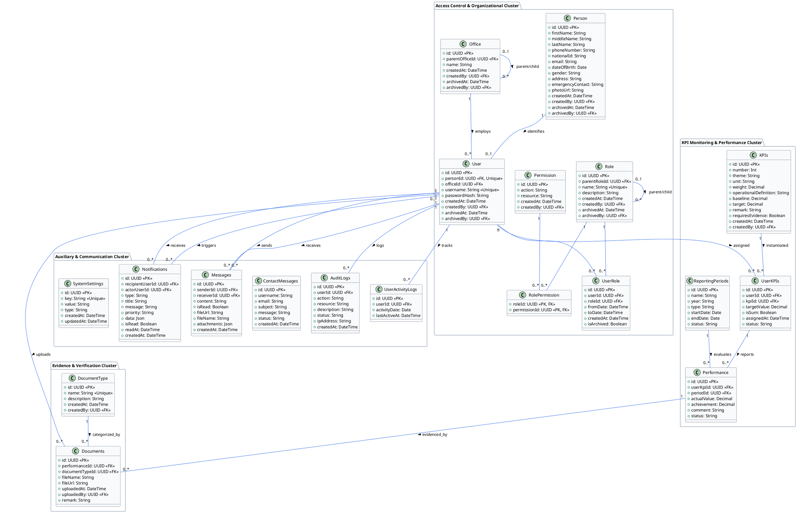
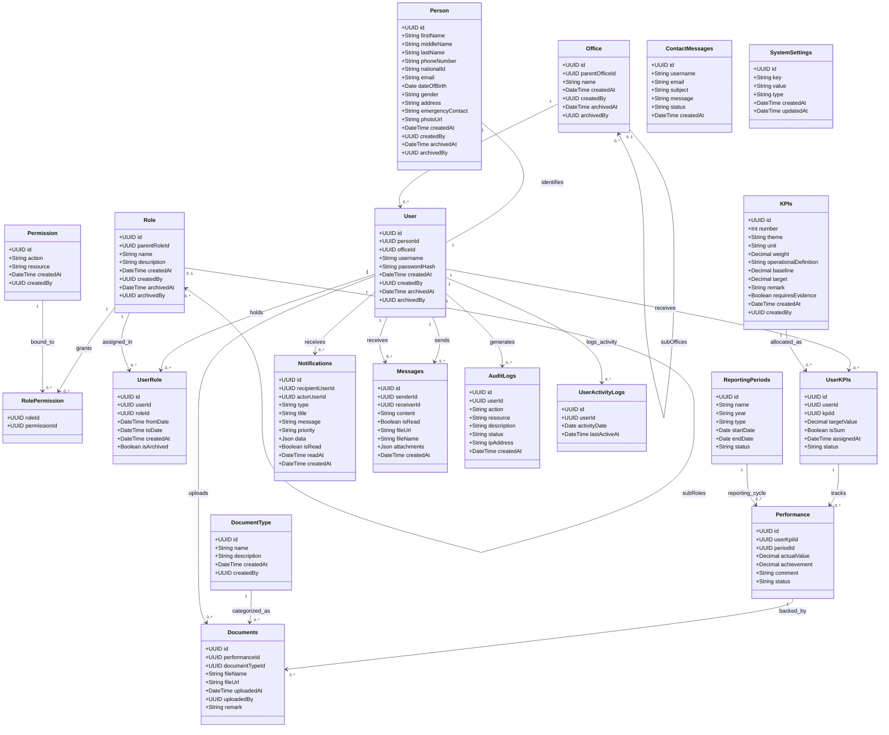

# Class Diagram - AMU-KPI-Monitoring-System

## Overview

This document provides the formal, fully synchronized Class Diagram for the **Arba Minch University (AMU) KPI Monitoring System**, mapped directly to the active PostgreSQL database schema managed via Prisma ORM.

The architecture is structured into four cohesive clusters:
1. **Access Control & Organizational Cluster** (`Person`, `User`, `Office`, `Role`, `Permission`, `RolePermission`, `UserRole`)
2. **KPI Monitoring & Performance Cluster** (`KPIs`, `UserKPIs`, `ReportingPeriods`, `Performance`)
3. **Evidence & Verification Cluster** (`DocumentType`, `Documents`)
4. **Auxiliary & Communication Cluster** (`Notifications`, `Messages`, `ContactMessages`, `AuditLogs`, `UserActivityLogs`, `SystemSettings`)

---

## 1. Class Structure Description

### Cluster 1: Access Control & Organizational Domain
- **Person**: Physical person demographic identity record, separating biological/human traits from login credentials.
- **User**: System credential account containing username, password hash, and active/archiving timestamps. Directly linked 1:1 with Person.
- **Office**: Recursive organizational tree structure representing University President, Vice Presidents, Directorates, Colleges, and Departments.
- **Role**: Recursive hierarchy of system and institutional roles (e.g. System Administrator, President, Dean, Head, Instructor).
- **Permission**: Atomic action-resource permission pairs (e.g., `CREATE_KPI`, `APPROVE_PERFORMANCE`).
- **RolePermission**: Join table assigning sets of permissions to specific roles (M:N).
- **UserRole**: Time-bounded role assignments connecting a User to one or more Roles with validity dates.

### Cluster 2: KPI Monitoring & Performance Tracking
- **KPIs**: Master institutional catalog of strategic indicators with weights, target baselines, measurement units, and operational definitions.
- **UserKPIs**: Individual target allocations assigning a master KPI to a specific User for an academic cycle, including summation or averaging flags.
- **ReportingPeriods**: Standard reporting cycles (e.g., `Q1 2026`, `Q2 2026`, `Annual 2026`) with status controls (`UPCOMING`, `OPEN`, `CLOSED`).
- **Performance**: Quarterly actual performance submissions entered against an assigned `UserKPI` for a specific `ReportingPeriod`, including evaluation review workflows (`PENDING`, `SUBMITTED`, `APPROVED`).

### Cluster 3: Evidence & Verification
- **DocumentType**: Standard taxonomy of acceptable verification evidence (e.g., `Report`, `Publication`, `Certificate`, `Photo`).
- **Documents**: Supporting proof files directly attached to a specific **`Performance`** quarterly submission record to prove reported achievement figures.

### Cluster 4: Auxiliary & Communication
- **Notifications**: System and user-triggered in-app alerts with priority levels (`low`, `medium`, `high`) and read tracking.
- **Messages**: Direct peer-to-peer communication between faculty and management, supporting attachments.
- **ContactMessages**: Public guest, faculty, or student inquiries submitted through the contact portal.
- **AuditLogs**: Comprehensive audit trail capturing user IP, resource touched, action taken, and execution status for security compliance.
- **UserActivityLogs**: Daily user attendance, last active timestamps, and engagement records.
- **SystemSettings**: Centralized key-value system parameters (e.g., `active_cycle_year`, `maintenance_mode`).

---

## 2. Detailed Attributes by Class

### Person
- `id: UUID` (PK)
- `firstName: String`
- `middleName: String`
- `lastName: String`
- `phoneNumber: String`
- `nationalId: String`
- `email: String` (Nullable)
- `dateOfBirth: Date` (Nullable)
- `gender: String` (Nullable)
- `address: String` (Nullable)
- `emergencyContact: String` (Nullable)
- `photoUrl: String` (Nullable)
- `createdAt: DateTime`
- `createdBy: UUID` (FK -> User, Nullable)
- `archivedAt: DateTime` (Nullable)
- `archivedBy: UUID` (FK -> User, Nullable)

### User
- `id: UUID` (PK)
- `personId: UUID` (Unique, FK -> Person)
- `officeId: UUID` (FK -> Office, Nullable)
- `username: String` (Unique)
- `passwordHash: String`
- `createdAt: DateTime`
- `createdBy: UUID` (FK -> User, Nullable)
- `archivedAt: DateTime` (Nullable)
- `archivedBy: UUID` (FK -> User, Nullable)

### Office
- `id: UUID` (PK)
- `parentOfficeId: UUID` (Self-referencing FK -> Office, Nullable)
- `name: String`
- `createdAt: DateTime`
- `createdBy: UUID` (FK -> User, Nullable)
- `archivedAt: DateTime` (Nullable)
- `archivedBy: UUID` (FK -> User, Nullable)

### Role
- `id: UUID` (PK)
- `parentRoleId: UUID` (Self-referencing FK -> Role, Nullable)
- `name: String` (Unique)
- `description: String` (Nullable)
- `createdAt: DateTime`
- `createdBy: UUID` (FK -> User, Nullable)
- `archivedAt: DateTime` (Nullable)
- `archivedBy: UUID` (FK -> User, Nullable)

### Permission
- `id: UUID` (PK)
- `action: String`
- `resource: String`
- `createdAt: DateTime`
- `createdBy: UUID` (FK -> User, Nullable)
- `archivedAt: DateTime` (Nullable)
- `archivedBy: UUID` (FK -> User, Nullable)

### RolePermission
- `roleId: UUID` (PK, FK -> Role)
- `permissionId: UUID` (PK, FK -> Permission)

### UserRole
- `id: UUID` (PK)
- `userId: UUID` (FK -> User)
- `roleId: UUID` (FK -> Role)
- `fromDate: DateTime`
- `toDate: DateTime` (Nullable)
- `createdAt: DateTime`
- `isArchived: Boolean`

### KPIs
- `id: UUID` (PK)
- `number: Int`
- `theme: String`
- `unit: String`
- `weight: Decimal(5,2)`
- `operationalDefinition: String` (Nullable)
- `baseline: Decimal(10,2)` (Nullable)
- `target: Decimal(10,2)`
- `remark: String` (Nullable)
- `requiresEvidence: Boolean`
- `createdAt: DateTime`
- `createdBy: UUID` (FK -> User, Nullable)
- `updatedAt: DateTime` (Nullable)
- `updatedBy: UUID` (FK -> User, Nullable)

### UserKPIs
- `id: UUID` (PK)
- `userId: UUID` (FK -> User)
- `kpiId: UUID` (FK -> KPIs)
- `targetValue: Decimal(10,2)`
- `isSum: Boolean`
- `assignedAt: DateTime`
- `status: String` (Default: "ACTIVE")

### ReportingPeriods
- `id: UUID` (PK)
- `name: String` (e.g., "Q1 2026")
- `year: String` (e.g., "2026")
- `type: String` ("QUARTERLY", "ANNUAL", "SPECIAL")
- `startDate: Date`
- `endDate: Date`
- `status: String` ("UPCOMING", "OPEN", "CLOSED")

### Performance
- `id: UUID` (PK)
- `userKpiId: UUID` (FK -> UserKPIs)
- `periodId: UUID` (FK -> ReportingPeriods)
- `actualValue: Decimal(10,2)`
- `achievement: Decimal(6,2)` (Nullable)
- `comment: String` (Nullable)
- `status: String` ("PENDING", "SUBMITTED", "APPROVED")

### DocumentType
- `id: UUID` (PK)
- `name: String` (Unique, e.g. "Report", "Publication")
- `description: String` (Nullable)
- `createdAt: DateTime`
- `createdBy: UUID` (FK -> User, Nullable)
- `updatedAt: DateTime` (Nullable)
- `updatedBy: UUID` (FK -> User, Nullable)

### Documents
- `id: UUID` (PK)
- `performanceId: UUID` (FK -> Performance)
- `documentTypeId: UUID` (FK -> DocumentType)
- `fileName: String`
- `fileUrl: String`
- `uploadedAt: DateTime`
- `uploadedBy: UUID` (FK -> User, Nullable)
- `remark: String` (Nullable)

### AuditLogs
- `id: UUID` (PK)
- `userId: UUID` (FK -> User, Nullable)
- `action: String`
- `resource: String` (Nullable)
- `description: String` (Nullable)
- `status: String` (Default: "Success")
- `ipAddress: String` (Nullable)
- `createdAt: DateTime`

### ContactMessages
- `id: UUID` (PK)
- `username: String`
- `email: String`
- `subject: String` (Nullable)
- `message: String`
- `status: String` (Default: "Unread")
- `createdAt: DateTime`
- `updatedAt: DateTime`

### Messages
- `id: UUID` (PK)
- `senderId: UUID` (FK -> User)
- `receiverId: UUID` (FK -> User)
- `content: String` (Nullable)
- `isRead: Boolean` (Default: false)
- `fileUrl: String` (Nullable)
- `fileName: String` (Nullable)
- `fileType: String` (Nullable)
- `attachments: Json` (Nullable)
- `createdAt: DateTime`
- `updatedAt: DateTime`

### Notifications
- `id: UUID` (PK)
- `recipientUserId: UUID` (FK -> User)
- `actorUserId: UUID` (FK -> User, Nullable)
- `type: String` (Nullable)
- `title: String` (Nullable)
- `message: String` (Nullable)
- `priority: String` ("low", "medium", "high")
- `data: Json` (Nullable)
- `isRead: Boolean` (Default: false)
- `readAt: DateTime` (Nullable)
- `createdAt: DateTime`
- `isArchived: Boolean` (Default: false)

### SystemSettings
- `id: UUID` (PK)
- `key: String` (Unique)
- `value: String` (Nullable)
- `type: String` (Default: "string")
- `createdAt: DateTime`
- `updatedAt: DateTime`

### UserActivityLogs
- `id: UUID` (PK)
- `userId: UUID` (FK -> User)
- `activityDate: Date`
- `lastActiveAt: DateTime` (Nullable)

---

## 3. PlantUML Class Diagram Code

---

## 4. Mermaid Class Diagram Code

---

## 5. Relationship Summary

| Source Entity | Target Entity | Multiplicity | Foreign Key | Cascade Rule | Description |
| :--- | :--- | :---: | :--- | :--- | :--- |
| **Person** | **User** | 1 : 1 | `user.person_id` | CASCADE on delete | A Person identity links to exactly one system login User. |
| **Office** | **Office** | 1 : M | `office.parent_office_id` | SET NULL | Recursive university organizational tree. |
| **Office** | **User** | 1 : M | `user.office_id` | SET NULL | An Office has multiple assigned member Users. |
| **Role** | **Role** | 1 : M | `role.parent_role_id` | SET NULL | Hierarchical role inheritance tree. |
| **Role** | **RolePermission** | 1 : M | `role_permission.role_id` | CASCADE | Maps roles to granular permission items. |
| **Permission**| **RolePermission** | 1 : M | `role_permission.permission_id` | CASCADE | Maps permissions to roles. |
| **User** | **UserRole** | 1 : M | `user_role.user_id` | CASCADE | A user can hold multiple roles across time. |
| **Role** | **UserRole** | 1 : M | `user_role.role_id` | CASCADE | A role can be assigned to multiple users. |
| **User** | **UserKPIs** | 1 : M | `user_kpis.user_id` | CASCADE | Individual KPI allocation to a responsible user. |
| **KPIs** | **UserKPIs** | 1 : M | `user_kpis.kpi_id` | CASCADE | Master KPI instantiated for a user target. |
| **UserKPIs** | **Performance** | 1 : M | `performance.user_kpi_id` | CASCADE | Multiple quarterly submissions for an assigned target. |
| **ReportingPeriods** | **Performance** | 1 : M | `performance.period_id` | CASCADE | Connects actual result to a quarterly reporting cycle. |
| **Performance** | **Documents** | 1 : M | `documents.performance_id` | CASCADE | **Direct link**: Proof documents substantiate quarterly results. |
| **DocumentType** | **Documents** | 1 : M | `documents.document_type_id` | CASCADE | Categorizes evidence (Publication, Report, Certificate). |
| **User** | **Documents** | 1 : M | `documents.uploaded_by` | SET NULL | Tracks the user account who uploaded the file. |
| **User** | **Messages** | 1 : M | `messages.sender_id` | CASCADE | Outbox messages sent by user. |
| **User** | **Messages** | 1 : M | `messages.receiver_id` | CASCADE | Inbox messages received by user. |
| **User** | **Notifications** | 1 : M | `notifications.recipient_user_id` | CASCADE | In-app alerts delivered to recipient user. |
| **User** | **AuditLogs** | 1 : M | `audit_logs.user_id` | SET NULL | Audit trail of administrative and data operations. |
| **User** | **UserActivityLogs** | 1 : M | `user_activity_logs.user_id` | CASCADE | Daily activity tracker per user account. |

---

## 6. Key Architecture & Design Decisions

### 1. Document Proof Direct Binding to Performance
- In the original design, documents were attached to `KPI` or `UserKPI` generically.
- In this **current schema**, `Documents` are linked directly to `Performance` (`documents.performance_id`).
- **Rationale:** Evidence is uploaded to prove a *specific quarter's actual submission* (e.g. Q1 publications, Q2 workshop reports), ensuring rigorous verification for evaluators and audit teams.

### 2. Physical Identity vs. System Account Separation
- `Person` contains physical and demographic identity (`firstName`, `middleName`, `lastName`, `nationalId`, `phoneNumber`, `email`, `gender`, `address`, `emergencyContact`, `photoUrl`).
- `User` contains credentials and authentication status (`username`, `passwordHash`, `officeId`, `personId`).
- **Benefit:** Allows institutional identity to remain intact even if user credentials, roles, or offices are reassigned or rotated.

### 3. Native P2P Communication & Notifications
- Replaced non-existent chat room entities with clean **`Messages`** (sender/receiver model with attachments) and **`Notifications`** (priority alerts with JSON metadata).
- Directly integrated with Socket.io in `Backend/realtime/socket.js`.

### 4. Dynamic Reporting Cycles
- Evaluators can open, close, and create dynamic reporting periods (`ReportingPeriods`) with dates and statuses (`UPCOMING`, `OPEN`, `CLOSED`), removing hardcoded quarter limits.
