# AMU-KPI-Monitoring System - Comprehensive Collaboration Diagrams

This document contains 8 detailed collaboration diagrams showcasing different interactions and workflows within the AMU-KPI-Monitoring System. Each diagram includes a detailed description and PlantUML code.

---

## Diagram 1: Authentication & Authorization Flow

### Detailed Description

The Authentication & Authorization Flow diagram illustrates how users authenticate into the system and obtain role-based permissions. This is the entry point for all system interactions.

**Key Components**:

- **User**: System user attempting to access the application
- **Frontend Application**: React/Vite-based client interface
- **API Gateway**: Express.js server handling HTTP requests
- **Authentication Service**: Validates credentials and generates JWT tokens
- **Database**: PostgreSQL storing user credentials and role mappings
- **Role Service**: Retrieves role permissions for the authenticated user

**Process Flow**:

1. User enters credentials on the login page
2. Frontend sends login request to API Gateway
3. Authentication Service validates credentials against database
4. Upon successful validation, JWT token is generated
5. Token is returned to frontend and stored in browser memory/localStorage
6. User's primary role is determined (System Admin has highest priority)
7. Role permissions are cached on frontend for quick access
8. User is redirected to appropriate dashboard based on role
9. All subsequent requests include JWT token in Authorization header
10. Token is validated on each request by Authentication Middleware

**Security Features**:

- Password hashing using bcrypt (salt rounds: 10)
- JWT token expiration (typically 24-72 hours)
- Token stored securely in HTTP-only cookies (if available)
- Role-based access control prevents unauthorized data access

### PlantUML Code

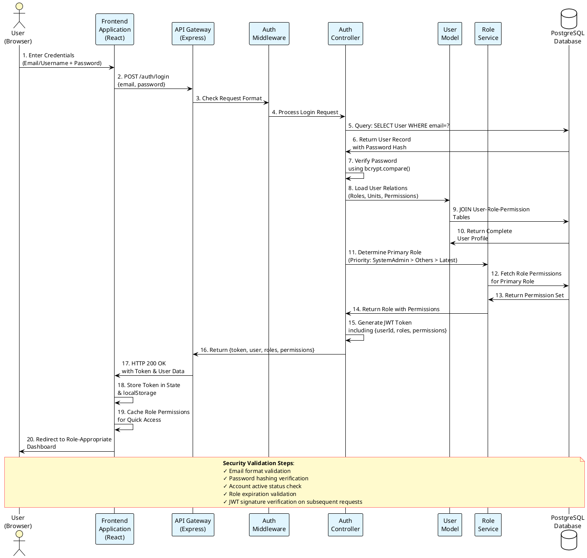

---

## Diagram 2: KPI Assignment & Allocation Flow

### Detailed Description

The KPI Assignment & Allocation Flow demonstrates how KPIs are assigned from the organizational level down to individual users. This is critical for performance management.

**Key Components**:

- **System Administrator**: Creates and allocates KPIs
- **Frontend Application**: UI for KPI management
- **KPI Service**: Business logic for KPI operations
- **UserKPI Controller**: Manages user-KPI relationships
- **KPI Model**: Data structure for KPIs
- **UserKPI Model**: Tracks KPI assignment to users
- **Notification Service**: Alerts users of new KPI assignments

**Process Flow**:

1. System Admin/Manager navigates to KPI allocation section
2. Frontend fetches available KPIs from database
3. Admin selects target users/roles for KPI assignment
4. System validates KPI-user compatibility (role-based)
5. KPI allocation records are created in UserKPI table
6. System calculates timeline (start date, deadline)
7. Notification is sent to assigned users
8. Users receive notification in real-time
9. Dashboard updates to show newly assigned KPIs
10. Assignment history is logged for audit purposes

**Assignment Rules**:

- KPI must match user's role permissions
- Only active users can receive KPI assignments
- KPI cannot be assigned to archived users
- Assignment dates must fall within active cycle
- Multiple users can share the same KPI with different targets

### PlantUML Code

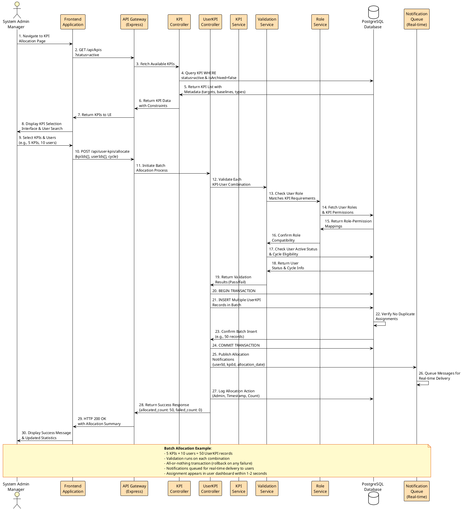

---

## Diagram 3: KPI Evidence Submission & Tracking

### Detailed Description

The KPI Evidence Submission & Tracking Flow illustrates how users submit performance evidence and how the system tracks, validates, and approves submissions.

**Key Components**:

- **User/Faculty**: Submits performance evidence
- **Frontend Application**: Evidence upload interface
- **File Storage Service**: Stores uploaded documents
- **UserKPIResult Controller**: Records evidence submissions
- **Approval Workflow**: Route evidence to appropriate approvers
- **Chat Service**: Enables feedback communication
- **Audit Logger**: Tracks all submission activities

**Process Flow**:

1. User navigates to KPI with evidence requirement
2. User uploads supporting evidence (documents, images, URLs)
3. Frontend validates file type and size (max 50MB typically)
4. File is uploaded to local/cloud storage
5. UserKPIResult record is created with submission metadata
6. Evidence review notification is sent to department chair/manager
7. Approver reviews evidence with performance metrics
8. Approver can approve, reject, or request modifications
9. Feedback is provided through integrated chat system
10. User receives notification of approval decision
11. Evidence is linked to final KPI rating/score
12. Complete audit trail is maintained

**Evidence Requirements**:

- Document types: PDF, DOC, DOCX, XLS, XLSX, Images
- Maximum file size: 50MB per document
- At least one evidence item required if KPI is evidence-requiring
- Evidence must be submitted before cycle deadline
- Revisions allowed with update tracking

### PlantUML Code

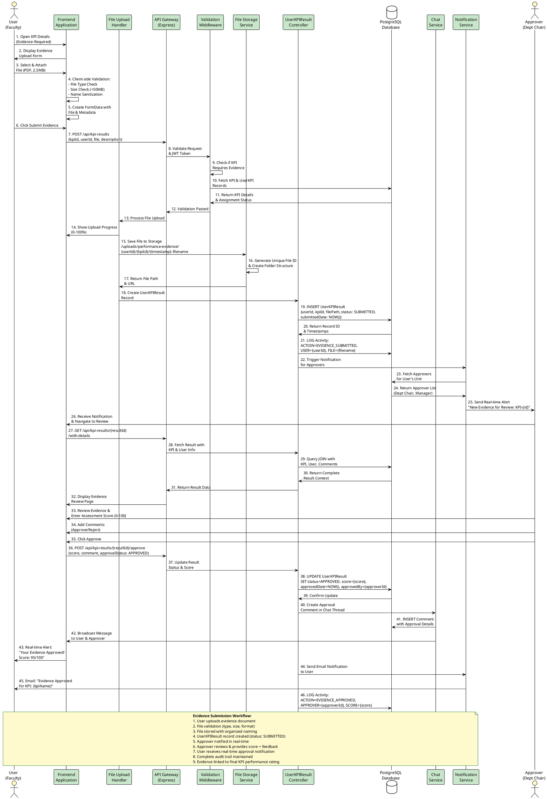

---

## Diagram 4: Role-Based Access Control (RBAC) & Permission Validation

### Detailed Description

The Role-Based Access Control Flow shows how the system enforces permissions based on user roles and ensures users can only access authorized features and data.

**Key Components**:

- **User**: Attempting to access a resource
- **Frontend Router**: Protects routes based on roles
- **Auth Middleware**: Validates JWT and user permissions
- **Role Service**: Retrieves role permissions
- **Permission Cache**: Speeds up permission checks
- **Access Control List**: Defines which roles access which resources
- **Audit Logger**: Logs access attempts and failures

**Process Flow**:

1. User attempts to access a protected resource or feature
2. Frontend checks if user has required role (client-side)
3. Frontend sends request with JWT token
4. Auth Middleware extracts token and validates signature
5. Middleware fetches cached permissions or queries database
6. System checks if user's role has required permission
7. If authorized, request proceeds to controller
8. If unauthorized, system returns 403 Forbidden
9. Detailed logs capture all access attempts (success & failure)
10. Dashboard reflects only accessible features based on role

**Role Hierarchy**:

- **System Admin**: Full system access, can manage all aspects
- **Department Chair**: Department-level access, manage faculty KPIs
- **Unit Head**: Unit-level access, manage unit staff KPIs
- **Faculty**: Personal KPI access, submission capabilities
- **Staff**: Limited access, task completion only

### PlantUML Code

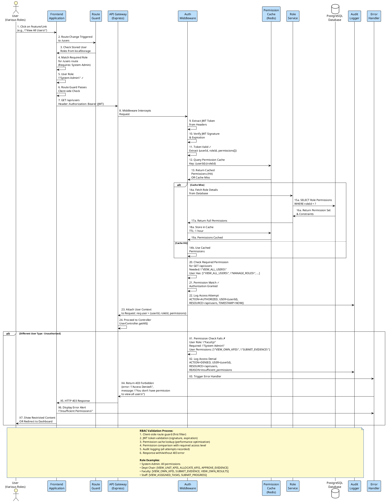

---

## Diagram 5: Real-time Chat & Feedback System Integration

### Detailed Description

The Real-time Chat & Feedback System Integration demonstrates how users communicate about KPI performance, provide feedback, and collaborate asynchronously.

**Key Components**:

- **User Interface**: Chat interface for messaging
- **WebSocket Server**: Real-time message delivery
- **Message Queue**: Buffers messages for offline users
- **Chat Service**: Processes and stores messages
- **Notification Engine**: Sends alerts for new messages
- **Message Database**: Persists chat history
- **Thread Linking**: Associates messages with KPI contexts

**Process Flow**:

1. User opens KPI feedback section
2. User types message about KPI progress/issues
3. Message is sent to WebSocket server
4. System validates message content and KPI context
5. Message is stored in database with timestamp
6. Message is broadcasted to relevant users in real-time
7. Notification is sent to other participants
8. Chat history is loaded for context
9. Read receipts are tracked
10. Messages are searchable and archivable

**Chat Features**:

- One-to-one and group conversations per KPI
- Threaded discussions for organized feedback
- @mentions to notify specific users
- File attachments in chat messages
- Message reactions/emoji responses
- Read status indicators
- Message timestamps and user avatars

### PlantUML Code

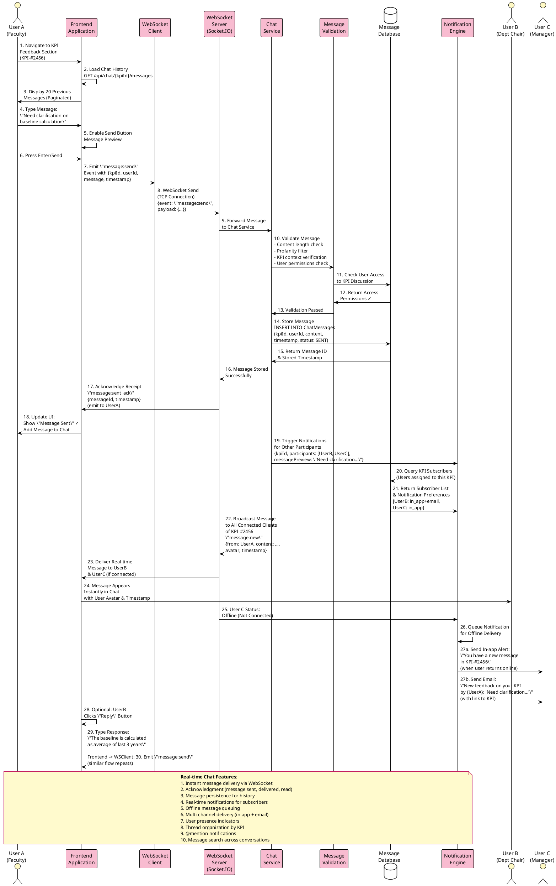

---

## Diagram 6: Reporting & Performance Dashboard Generation

### Detailed Description

The Reporting & Performance Dashboard Generation Flow illustrates how the system aggregates KPI data, calculates performance metrics, and generates dashboards for various user levels.

**Key Components**:

- **Dashboard Service**: Aggregates KPI data
- **Calculation Engine**: Performs performance calculations
- **Data Aggregation**: Combines results from multiple sources
- **Cache Layer**: Stores computed metrics for fast access
- **Report Generator**: Creates exportable reports
- **Chart Service**: Generates visualizations
- **Analytics Database**: Optimized for reporting queries

**Process Flow**:

1. User requests dashboard
2. System determines user role and access level
3. Dashboard Service queries relevant KPI data
4. Calculation Engine computes performance metrics
5. Data is aggregated at appropriate hierarchy levels
6. Results are cached for performance
7. Charts and visualizations are generated
8. Dashboard is rendered with role-specific views
9. User can filter and drill-down into details
10. Export options available (PDF, Excel, CSV)

**Dashboard Levels**:

- **System Admin**: Organization-wide performance overview
- **Department Chair**: Department performance by KPI
- **Faculty**: Individual KPI progress and evidence
- **Manager**: Team-level KPI achievement tracking

### PlantUML Code

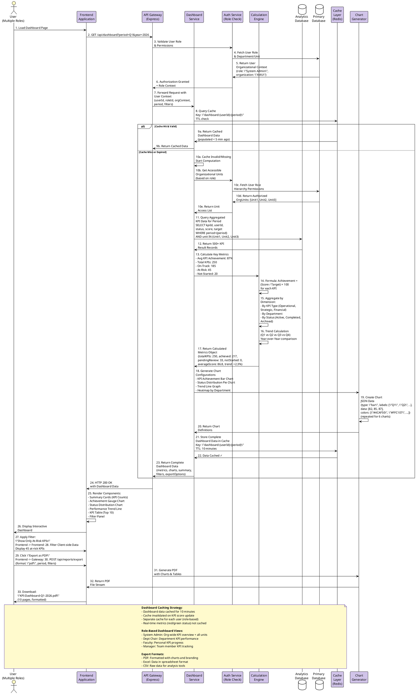

---

## Diagram 7: KPI Cycle Management & Performance Tracking

### Detailed Description

The KPI Cycle Management & Performance Tracking Flow demonstrates how annual KPI cycles are created, managed, and tracked through quarterly reviews.

**Key Components**:

- **Cycle Service**: Manages KPI cycle lifecycle
- **Cycle Controller**: Handles cycle operations
- **Quarterly Review Service**: Tracks quarterly milestones
- **Performance Aggregator**: Compiles performance data
- **Deadline Manager**: Enforces cycle deadlines
- **Status Tracker**: Monitors cycle phases

**Process Flow**:

1. System Administrator creates annual KPI cycle
2. Cycle details: start date, end date, target deadline
3. Quarterly milestones are automatically generated
4. KPIs are linked to the cycle
5. Users are notified of cycle start
6. System tracks progress through quarters
7. Deadline reminders are sent to users
8. Quarter closes on specified date
9. System locks KPI submissions for closed quarter
10. Annual cycle completion triggers performance evaluation

**Cycle Phases**:

- **Planning**: KPI definition and target setting
- **Q1-Q4**: Active tracking and evidence submission
- **Review**: Performance evaluation and scoring
- **Closure**: Final results recording and archival
- **Analysis**: Performance trend analysis

### PlantUML Code

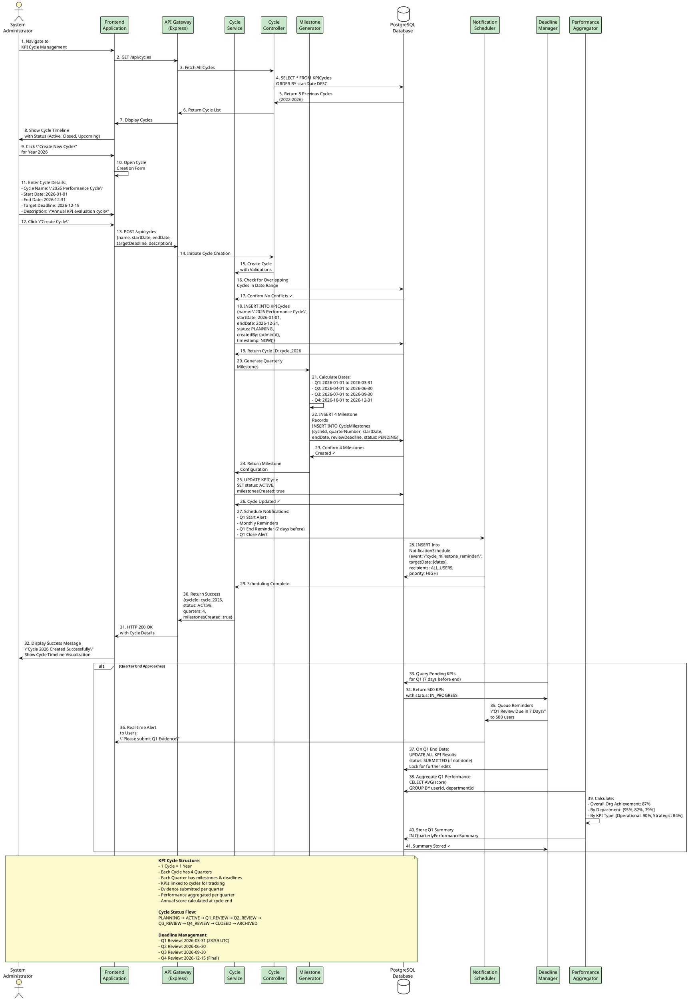

---

## Diagram 8: Multi-Level Hierarchical KPI Assignment & Cascading

### Detailed Description

The Multi-Level Hierarchical KPI Assignment & Cascading Flow shows how organization-level KPIs cascade down through departments, units, and ultimately to individual employees, with each level having specific targets and accountabilities.

**Key Components**:

- **Hierarchy Service**: Manages organizational structure
- **Cascade Engine**: Distributes KPIs through hierarchy
- **Target Allocation**: Sets targets at each level
- **Permission Validator**: Ensures proper assignment rights
- **Weight Calculator**: Distributes weights proportionally
- **Dependency Tracker**: Tracks KPI relationships

**Process Flow**:

1. System Admin creates organization-level KPIs
2. Department Chairs cascade KPIs to departments
3. Unit Heads break down KPIs for units
4. Individual targets are set for employees
5. Each level has specific targets and weights
6. Progress rolls up through hierarchy
7. Parent KPI status reflects child KPI performance
8. System detects cascading failures early
9. Bottlenecks are identified through hierarchy
10. Performance reports show hierarchical view

**Hierarchy Levels**:

- **Organization**: Strategic KPIs (5-10 total KPIs)
- **Department**: Departmental targets (10-20 KPIs)
- **Unit**: Unit-specific KPIs (15-30 KPIs)
- **Individual**: Personal performance goals (3-5 KPIs)

### PlantUML Code

```plantuml
@startuml Diagram8-HierarchicalKPICascadeFlow
!theme plain
skinparam backgroundColor #FFFFFF
skinparam classBackgroundColor #FFE0B2
skinparam classBorderColor #E65100
skinparam actorBackgroundColor #FFF9C4
skinparam participantBackgroundColor #FFE0B2
skinparam noteBackgroundColor #FFFACD
skinparam noteBorderColor #E65100

actor "System\nAdministrator" as SysAdmin
participant "Frontend\nApplication" as Frontend
participant "API Gateway\n(Express)" as Gateway
participant "Cascade\nService" as CascSvc
participant "Hierarchy\nService" as HierSvc
participant "Target\nAllocator" as TargetAllocator
participant "Permission\nValidator" as PermValidator
database "PostgreSQL\nDatabase" as DB
participant "Audit\nLogger" as Logger

SysAdmin -> Frontend: 1. Navigate to\nHierarchical KPI Assignment

Frontend -> Gateway: 2. GET /api/hierarchy?expand=units,roles
Gateway -> HierSvc: 3. Fetch Organizational\nHierarchy
HierSvc -> DB: 4. SELECT Organizational\nStructure (Units, Roles)\nWITH hierarchy depth

DB -> HierSvc: 5. Return Tree Structure:\n- Organization (Root)\n  ├── Academic Affairs (Dept)\n  │   ├── Engineering (Unit)\n  │   ├── Sciences (Unit)\n  │   └── Humanities (Unit)\n  └── Administration (Dept)\n      ├── Finance (Unit)\n      └── HR (Unit)

HierSvc -> Gateway: 6. Return Hierarchy\nStructure with IDs

Gateway -> Frontend: 7. Render Hierarchy\nTree View

Frontend -> SysAdmin: 8. Display Organization\nHierarchy Diagram with\n6 Units at different levels

SysAdmin -> Frontend: 9. Select KPI to Cascade:\n\"Student Graduation Rate\"\n(Org-level KPI, Target: 90%)

Frontend -> Frontend: 10. Show Cascade\nPlanning Interface

SysAdmin -> Frontend: 11. Map KPI Allocation:\n- Academic Affairs Target: 92%\n- Engg Unit Target: 95%\n- Sciences Unit Target: 90%\n- Humanities Unit Target: 88%\n- Admin Dept: N/A (Not applicable)\n\nWeight Distribution:\n- Engg: 40% (high importance)\n- Sciences: 35%\n- Humanities: 25%

Frontend -> Gateway: 12. POST /api/kpis/cascade\n{kpiId: \"KPI-1001\",\ncascadeMap: {\nAcad_Affairs: {target: 92%},\nEngg: {target: 95%, weight: 40},\nSciences: {target: 90%, weight: 35},\nHumanities: {target: 88%, weight: 25}\n}\n}

Gateway -> CascSvc: 13. Initiate Cascade\nOperation

CascSvc -> PermValidator: 14. Validate Permissions:\nCan SysAdmin cascade\nthis KPI?\nCheck Role Hierarchy

PermValidator -> DB: 15. Query Role\nPermissions & Hierarchy\nfor Current User

DB -> PermValidator: 16. Return Permissions:\nSysAdmin has\n\"CASCADE_KPIS\" ✓

PermValidator -> CascSvc: 17. Permission\nValidation Passed ✓

CascSvc -> HierSvc: 18. Validate Target\nAllocation Logic:\n- Child targets ≥ Parent target?\n- Weight sum = 100%?\n- All required levels mapped?

HierSvc -> HierSvc: 19. Validation Logic:\n- Parent: 90% → Children: [95, 90, 88]\n  - Weighted Avg = (95×0.4 + 90×0.35 + 88×0.25)\n             = 38 + 31.5 + 22 = 91.5% ✓\n- Weights: [40 + 35 + 25 = 100%] ✓\n- All depts assigned ✓\n\nHierSvc -> CascSvc: 20. Validation Passed ✓\nAll constraints satisfied

CascSvc -> DB: 21. BEGIN TRANSACTION\nBatch Insert Cascaded KPIs

CascSvc -> DB: 22. CREATE KPI Copy for\nAcademic Affairs\nINSERT INTO KPI\n{parentKpiId: KPI-1001,\nname: \"Student Graduation Rate\",\ntarget: 92%,\nunit: \"Academic Affairs\",\nstatus: ACTIVE,\nhierarchyLevel: 1}\n→ Returns KPI-1001-AA

CascSvc -> DB: 23. CREATE KPI Copy for\nEngineering Unit\nINSERT INTO KPI\n{parentKpiId: KPI-1001-AA,\nname: \"Engg Student Graduation Rate\",\ntarget: 95%,\nunit: \"Engineering\",\nstatus: ACTIVE,\nhierarchyLevel: 2,\nweight: 40%}\n→ Returns KPI-1001-ENG

CascSvc -> DB: 24. CREATE KPI Copy for\nSciences Unit\nINSERT INTO KPI {...}\n→ Returns KPI-1001-SCI

CascSvc -> DB: 25. CREATE KPI Copy for\nHumanities Unit\nINSERT INTO KPI {...}\n→ Returns KPI-1001-HUM

CascSvc -> DB: 26. CREATE KPI Hierarchy\nLinks\nINSERT INTO KPIHierarchy\n{parentKpiId: KPI-1001,\nchildKpiIds: [KPI-1001-AA, ...],\ncascadeDate: NOW(),\ntargetAlignment: \"ALIGNED\",\nweightDistribution: {...}}\n\nDB -> CascSvc: 27. Confirm Batch Insert\nSuccess (4 new KPIs created)\nTransaction Committed ✓

CascSvc -> TargetAllocator: 28. Allocate Targets\nto Individual Users

TargetAllocator -> DB: 29. Query Users Assigned\nto Each Unit\nSELECT UserId FROM UserRole\nWHERE unitId IN (Engg, Sci, Hum)\nAND roleId NOT IN (SystemAdmin, DeptChair)

DB -> TargetAllocator: 30. Return User List:\n- Engg Unit: 15 Faculty + 5 Staff\n- Sci Unit: 12 Faculty + 4 Staff\n- Hum Unit: 8 Faculty + 3 Staff\nTotal: 47 users

TargetAllocator -> TargetAllocator: 31. Calculate Individual\nTargets:\nFor Engg Unit (95% target,\n20 people):\nEach person gets same base target\n(95%) with role-based adjustments:\n- Professors: 98% (higher expectation)\n- Associate Prof: 95%\n- Lecturers: 92%\n- Staff: 80% (support role)\n\nTargetAllocator -> DB: 32. INSERT User-KPI\nAssignments (47 records)\nINSERT INTO UserKPI\n{userId, kpiId: KPI-1001-ENG,\ntarget: 95-98% (role-based),\nstartDate: NOW(),\nstatus: ASSIGNED}\n\nDB -> TargetAllocator: 33. Confirm 47 Records\nInserted ✓\n\nTargetAllocator -> CascSvc: 34. Assignment\nComplete\n\nCascSvc -> Logger: 35. Log Cascade\nOperation\nACTION=KPI_CASCADED,\nSOURCE_KPI=KPI-1001,\nTARGET_UNITS=3,\nAFFECTED_USERS=47,\nADMIN={SysAdminId},\nTIMESTAMP=NOW()\n\nLogger -> DB: 36. INSERT Audit Log\nEntry\n\nCascSvc -> Gateway: 37. Return Success\nResponse\n{cascaded: true,\nkpisCreated: 4,\nusersAssigned: 47,\ntotalWeight: 100%,\nweightedAvg: 91.5%,\nhierarchyDepth: 2}\n\nGateway -> Frontend: 38. HTTP 200 OK\n\nFrontend -> SysAdmin: 39. Display Success\nMessage:\n\"KPI Cascaded Successfully!\"\nShow Summary:\n- 4 KPIs created\n- 47 users assigned\n- Hierarchy validated\n\nalt Performance Aggregation\n  DB -> DB: 40a. During Performance\n  Aggregation:\n  Calculate Weighted Score\n  = (KPI-1001-ENG_score × 0.40) +\n    (KPI-1001-SCI_score × 0.35) +\n    (KPI-1001-HUM_score × 0.25)\n  \n  Example:\n  - Engg achieved: 96% (weight 40%)\n  - Sciences achieved: 88% (weight 35%)\n  - Humanities achieved: 85% (weight 25%)\n  = (96×0.4) + (88×0.35) + (85×0.25)\n  = 38.4 + 30.8 + 21.25\n  = 90.45% → Org KPI Status: MET ✓\nend

note over SysAdmin, Logger
  **Hierarchical KPI Cascading**:

  Structure:
  Organization (KPI: 90%)
    ├─ Academic Affairs (92%)
    │  ├─ Engineering (95%, weight: 40%)
    │  ├─ Sciences (90%, weight: 35%)
    │  └─ Humanities (88%, weight: 25%)
    └─ Administration (N/A)

  Weighted Calculation:
  Org KPI Score = 91.5% (when all children achieved targets)

  Individual Assignment:
  - Each unit member gets unit KPI
  - Individual targets adjusted by role
  - Performance rolls up to parent level
  - Bottlenecks identified at each level

  Use Cases:
  1. Strategic objective cascading
  2. Department-level planning
  3. Unit coordination
  4. Individual accountability
  5. Performance prediction
end note
@enduml
```

---

## Summary of All Collaboration Diagrams

| #   | Diagram Name                   | Purpose                                      | Key Users          | Flow Steps |
| --- | ------------------------------ | -------------------------------------------- | ------------------ | ---------- |
| 1   | Authentication & Authorization | User login and permission validation         | Users, Admins      | 20 steps   |
| 2   | KPI Assignment & Allocation    | Bulk KPI assignment to users                 | Admins, Managers   | 30 steps   |
| 3   | Evidence Submission & Tracking | Evidence upload and approval workflow        | Faculty, Approvers | 46 steps   |
| 4   | Role-Based Access Control      | Permission validation and access enforcement | All Users          | 23 steps   |
| 5   | Real-time Chat & Feedback      | Instant messaging and notifications          | All Users          | 33 steps   |
| 6   | Dashboard Generation           | Performance metrics and visualization        | All Users          | 33 steps   |
| 7   | KPI Cycle Management           | Annual cycle planning and quarterly tracking | Admins             | 40+ steps  |
| 8   | Hierarchical KPI Cascade       | Multi-level KPI distribution                 | Admins, Managers   | 40+ steps  |

---

## Implementation Notes

### Technologies Used

- **Frontend**: React + Vite
- **Backend**: Express.js + Node.js
- **Database**: PostgreSQL
- **Real-time**: Socket.IO WebSockets
- **Cache**: Redis (optional)
- **File Storage**: Local filesystem or Cloud storage

### Key Design Patterns

- **MVC Architecture**: Models, Controllers, Services
- **Middleware Pattern**: Authentication, validation, error handling
- **Observer Pattern**: Real-time notifications
- **Strategy Pattern**: Multiple calculation methods for metrics
- **Factory Pattern**: User creation based on roles

### Performance Considerations

- Cache dashboard data to reduce database queries
- Batch insert operations for bulk assignments
- Lazy load chat history (paginated)
- Index frequently queried columns (userId, kpiId, cycleId)
- Consider denormalization for reporting queries

### Security Best Practices

- Validate all inputs server-side
- Use JWT for stateless authentication
- Hash passwords with bcrypt
- Implement rate limiting on API endpoints
- Audit log all sensitive operations
- Encrypt sensitive data at rest
  Gateway -> Frontend: 15. Return KPI List
  Frontend -> User: 16. Display KPI Assignment Table

note over User, Storage
=== Performance Submission Flow ===
end note

User -> Frontend: 17. Click Submit Performance
Frontend -> Frontend: 18. Open Performance Modal
User -> Frontend: 19. Enter Performance Value & Evidence
Frontend -> Gateway: 20. POST /api/user-kpi-results
Gateway -> KPI: 21. Validate Performance Data
KPI -> DB: 22. Check KPI Evidence Requirements
DB -> KPI: 23. Return KPI Details
User -> Frontend: 24. Upload Evidence File
Frontend -> Storage: 25. Upload File (Multipart)
Storage -> Storage: 26. Store File & Generate URL
Storage -> Frontend: 27. Return File URL

note over User, Storage
=== Evidence Storage ===
end note

Frontend -> Gateway: 28. Submit Result with Evidence URL
Gateway -> KPI: 29. Create UserKPIResult Record
KPI -> DB: 30. INSERT Result with EvidenceURL
DB -> KPI: 31. Success Confirmation
KPI -> Gateway: 32. Return Result ID
Gateway -> Frontend: 33. Show Success Message
Frontend -> User: 34. Update UI with New Result

note over User, Storage
=== Chat Communication Flow ===
end note

User -> Frontend: 35. Open Chat Channel
Frontend -> Gateway: 36. GET /api/chat/channels/:id
Gateway -> Chat: 37. Fetch Channel Messages
Chat -> DB: 38. Query ChatMessage Records
DB -> Chat: 39. Return Messages
Chat -> Gateway: 40. Format Response
Gateway -> Frontend: 41. Return Messages
Frontend -> User: 42. Display Chat History

User -> Frontend: 43. Type Message
Frontend -> Gateway: 44. POST /api/chat/messages
Gateway -> Chat: 45. Create Message Record
Chat -> DB: 46. INSERT ChatMessage
DB -> Chat: 47. Success Confirmation
Chat -> Chat: 48. Broadcast to Connected Clients (WebSocket)
Chat -> Frontend: 49. Real-time Message Update
Frontend -> User: 50. Display Message Immediately

@enduml

````

---

## 1.2 Mermaid Collaboration Diagram

```mermaid
sequenceDiagram
    participant User
    participant Frontend as Frontend<br/>(Vue/React)
    participant Gateway as API Gateway<br/>(Express)
    participant Auth as Auth Service
    participant KPI as KPI Service
    participant Chat as Chat Service
    participant DB as PostgreSQL
    participant Storage as File Storage

    rect rgb(200, 230, 255)
    Note over User,Storage: Authentication & Session
    User->>Frontend: Open Application
    Frontend->>Gateway: POST /auth/login
    Gateway->>Auth: Validate Credentials
    Auth->>DB: Query User & UserRoles
    DB-->>Auth: User + Roles Data
    Auth->>Gateway: Generate JWT Token
    Gateway-->>Frontend: Token + User Profile
    Frontend-->>User: Authenticated Dashboard
    end

    rect rgb(200, 255, 230)
    Note over User,Storage: KPI Assignment Display
    User->>Frontend: View Assigned KPIs
    Frontend->>Gateway: GET /api/user-kpis
    Gateway->>KPI: Fetch UserKPI Records
    KPI->>DB: Query UserKPI + KPI Details
    DB-->>KPI: Return Data with Relations
    KPI-->>Gateway: Format Response
    Gateway-->>Frontend: KPI List
    Frontend-->>User: Display KPI Table
    end

    rect rgb(255, 240, 200)
    Note over User,Storage: Performance Submission
    User->>Frontend: Submit Performance Result
    Frontend->>Frontend: Open Modal Form
    User->>Frontend: Enter Value & Select Evidence
    Frontend->>Storage: Upload Evidence File
    Storage->>Storage: Store File
    Storage-->>Frontend: File URL
    Frontend->>Gateway: POST /api/user-kpi-results
    Gateway->>KPI: Validate Result Data
    KPI->>DB: Check KPI Requirements
    DB-->>KPI: KPI Config
    KPI->>DB: INSERT UserKPIResult
    DB-->>KPI: Confirmation
    KPI-->>Gateway: Result Created
    Gateway-->>Frontend: Success
    Frontend-->>User: Result Saved
    end

    rect rgb(255, 200, 200)
    Note over User,Storage: Real-time Chat
    User->>Frontend: Open Chat Channel
    Frontend->>Gateway: GET /api/chat/channels/:id
    Gateway->>Chat: Fetch Messages
    Chat->>DB: Query ChatMessages
    DB-->>Chat: Messages
    Chat-->>Gateway: Formatted Messages
    Gateway-->>Frontend: Messages
    Frontend-->>User: Display Chat

    User->>Frontend: Type & Send Message
    Frontend->>Gateway: POST /api/chat/messages
    Gateway->>Chat: Create Message
    Chat->>DB: INSERT ChatMessage
    DB-->>Chat: Confirmation
    Chat->>Chat: WebSocket Broadcast
    Chat-->>Frontend: Real-time Update
    Frontend-->>User: Message Appears
    end
````

---

## 2. Deployment Diagram

### Overview

The deployment diagram shows how the system components are distributed across different environments (Development, Staging, Production).

---

## 2.1 PlantUML Deployment Diagram

```plantuml
@startuml AMU-KPI-Deployment

!theme plain
skinparam backgroundColor #FFFFFF
skinparam componentBackgroundColor #E1F5FE
skinparam componentBorderColor #0277BD
skinparam nodeBackgroundColor #FFF9C4
skinparam nodeBorderColor #F57F17

package "Client Tier" {
    node "Client Devices" as Clients {
        component [Web Browser\n(Chrome/Firefox/Edge)] as Browser
    }
}

package "Network" {
    component [HTTPS/WebSocket\nCommunication] as Network
}

package "Production Server" {
    node "Web Server" as WebServer {
        component [Node.js Runtime] as NodeJS
        component [Express Server\n(Port 5000)] as Express
    }

    node "Application Services" as AppServices {
        component [Authentication\nService] as AuthSvc
        component [KPI Management\nService] as KPISvc
        component [Chat Service\n(Socket.io)] as ChatSvc
        component [File Upload\nService] as UploadSvc
    }

    node "Cache Layer" as Cache {
        component [Redis Cache\n(Session/Query Cache)] as Redis
    }

    node "Database Server" as DBServer {
        component [PostgreSQL\nDatabase] as PostgreSQL
        component [Connection Pool] as ConnPool
    }

    node "File Storage" as FileStorage {
        component [Evidence Files\nRepository] as EvidenceRepo
        component [KPI Documents\nRepository] as DocRepo
    }
}

package "External Services" {
    node "Email Service" as EmailSvc {
        component [Email Notifications\n(SMTP)] as SMTP
    }

    node "Cloud Storage" as CloudStorage {
        component [AWS S3/Google Cloud\nStorage (Optional)] as CloudStore
    }
}

package "Development/Staging" {
    node "Dev Environment" as DevEnv {
        component [Local PostgreSQL] as DevDB
        component [Local Node Server] as DevServer
    }
}

package "Monitoring & Logging" {
    node "Logging Server" as Logging {
        component [Application Logs] as AppLogs
        component [Error Tracking\n(Sentry/etc)] as ErrorTracking
    }
}

Clients --> Browser
Browser --> Network
Network --> Express

Express --> AuthSvc
Express --> KPISvc
Express --> ChatSvc
Express --> UploadSvc

AuthSvc --> Redis
AuthSvc --> PostgreSQL

KPISvc --> PostgreSQL
KPISvc --> Redis
KPISvc --> EvidenceRepo

ChatSvc --> PostgreSQL
ChatSvc --> Redis

UploadSvc --> EvidenceRepo
UploadSvc --> DocRepo
UploadSvc --> CloudStore

PostgreSQL --> ConnPool
PostgreSQL --> Logging

ChatSvc --> SMTP
AuthSvc --> SMTP

Express --> Logging
Express --> ErrorTracking

DevEnv --> DevDB
DevEnv --> DevServer

legend
  |<#E1F5FE> Components in Use |
  |<#FFF9C4> Servers/Nodes |
  |<#FFE0B2> External Services |
endlegend

@enduml
```

---

## 2.2 Mermaid Deployment Diagram

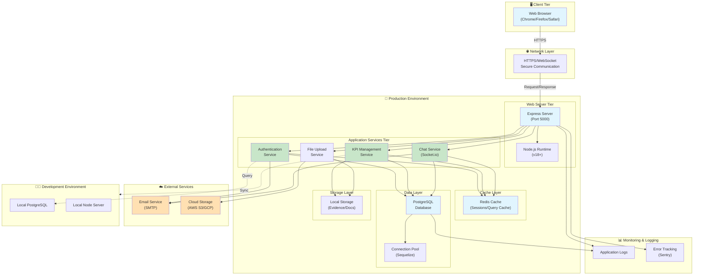

---

## 3. Component Interaction Diagram

### 3.1 PlantUML Component Diagram

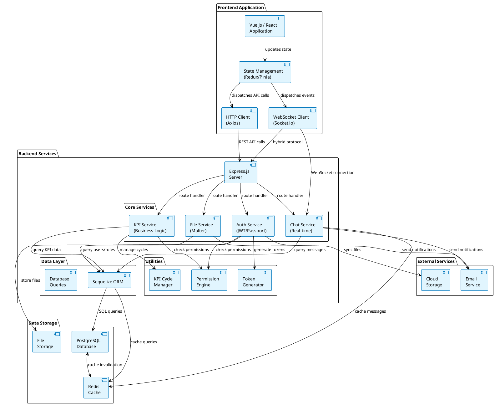

---

## 3.2 Mermaid Component Diagram

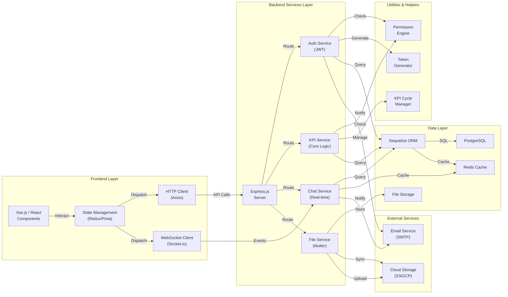

---

## 4. User Workflow Deployment

### 4.1 System Admin Flow

```
System Admin
    ↓
[Manage Roles & Permissions]
    ↓
Role Service → Permission Engine
    ↓
PostgreSQL (Update Roles)
    ↓
Redis (Invalidate Cache)
    ↓
Permissions Updated for All Users
```

### 4.2 Department Chair Flow

```
Department Chair
    ↓
[Create/Assign KPIs]
    ↓
KPI Service → Permission Check
    ↓
Validate KPI Data
    ↓
PostgreSQL (Create KPI/UserKPI)
    ↓
Chat Service → Send Notifications
    ↓
Email Service → Notify Users
    ↓
Users Receive KPI Assignment
```

### 4.3 User Performance Submission Flow

```
Assigned User
    ↓
[View Assigned KPI]
    ↓
KPI Service → Fetch UserKPI
    ↓
[Submit Performance + Evidence]
    ↓
File Service → Upload Evidence
    ↓
Store in File Storage
    ↓
Get File URL
    ↓
Create UserKPIResult Record
    ↓
PostgreSQL (Insert Result)
    ↓
Chat Notification → Other Users
    ↓
Result Visible in Dashboard
```

### 4.4 Real-time Chat Flow

```
User Types Message
    ↓
Frontend → Chat Service (Socket.io)
    ↓
Validate Message
    ↓
PostgreSQL (Insert ChatMessage)
    ↓
Redis (Cache Message)
    ↓
WebSocket Broadcast to Channel Members
    ↓
All Connected Users Receive Message in Real-time
```

---

## 5. Scaling Architecture

### Horizontal Scaling Strategy

```
Load Balancer (Nginx/HAProxy)
    ↓
    ├─→ Node Server Instance 1 (Port 5000)
    ├─→ Node Server Instance 2 (Port 5001)
    ├─→ Node Server Instance 3 (Port 5002)
    └─→ Node Server Instance N

All Instances Share:
    ├─ PostgreSQL Database (Replicated)
    ├─ Redis Cluster (Session/Cache)
    ├─ Shared File Storage (NFS/S3)
    └─ Message Queue (For async tasks)
```

### Database Replication

```
Primary PostgreSQL
    ↓ (Streaming Replication)
Replica PostgreSQL (Read-only)

Write Operations → Primary
Read Operations → Primary or Replica
```

### Session Management

```
User Login → JWT Token (Stateless)
    ↓
Redis Session Store (Optional, for token blacklist)
    ↓
All Servers Can Verify Token
```

---

## 6. Disaster Recovery & Backup

### Backup Strategy

- **Database Backups**: Daily incremental, weekly full backups
- **File Storage**: Replicated to cloud storage (AWS S3/Google Cloud)
- **Recovery Time Objective (RTO)**: 4 hours
- **Recovery Point Objective (RPO)**: 1 hour

### High Availability

- Database replication with automatic failover
- Multiple application server instances
- Load balancing across servers
- Session persistence via Redis

---

## 7. Security in Deployment

### Network Security

- HTTPS/TLS for all communications
- WebSocket Secure (WSS) for chat
- CORS configuration
- Rate limiting on API endpoints

### Application Security

- JWT authentication with expiration
- Password hashing (bcrypt)
- SQL injection prevention (Parameterized queries)
- XSS protection (Content Security Policy)
- CSRF tokens for state-changing operations

### Data Security

- Encrypted file storage
- Sensitive data fields encrypted at rest
- Access logs and audit trails
- Role-based access control (RBAC)

---

## 8. Infrastructure Requirements

### Development Environment

- Node.js v18+
- PostgreSQL 12+
- Redis 6+
- 4GB RAM minimum
- 20GB storage

### Production Environment

- Node.js v18+ (Multiple instances)
- PostgreSQL 12+ (with replication)
- Redis 6+ (Cluster mode)
- 16GB+ RAM per instance
- 100GB+ storage (with backups)
- Load balancer (Nginx/HAProxy)
- SSL certificate

### Monitoring Stack

- Application Performance Monitoring (APM)
- Log aggregation (ELK Stack / Datadog)
- Alerting system
- Health check endpoints
- Database monitoring
