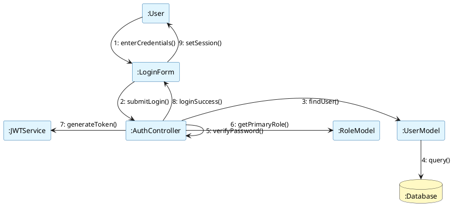
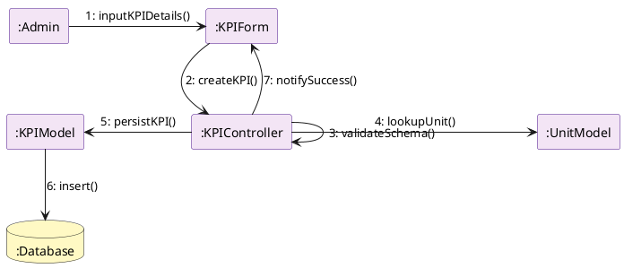
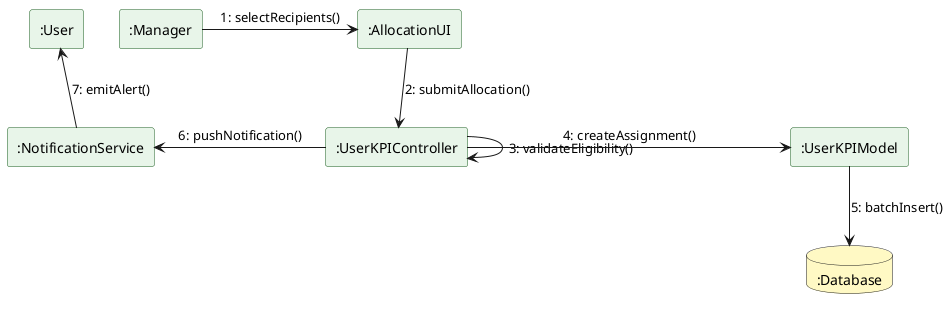
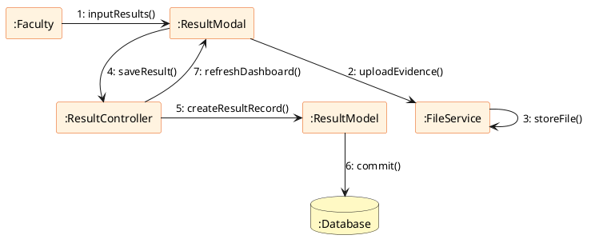
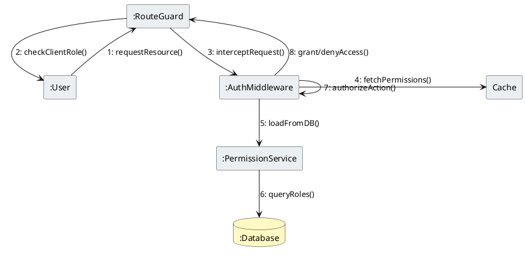
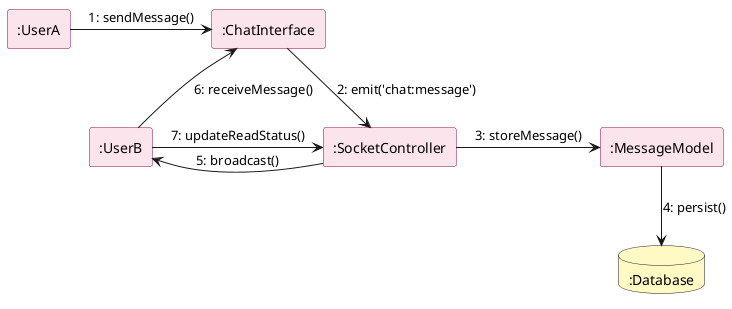

# AMU-KPI-Monitoring-System: Collaboration Diagram Descriptions

This document provides detailed descriptions of the collaboration diagrams for the six primary modules of the AMU-KPI-Monitoring-System. These diagrams illustrate the structural relationships between system objects and the sequence of messages exchanged to perform specific business processes.

---

## 1. Authentication & Authorization Module

**Goal**: Securely authenticate users and establish their role-based session.

### Collaboration Diagram (PlantUML)

### Participating Objects
- **:User**: The actor interacting with the browser.
- **:LoginForm**: The React UI component for credential entry.
- **:AuthController**: The Express.js controller handling authentication logic.
- **:JWTService**: Utility for generating and signing security tokens.
- **:UserModel**: Data entity representing user records.
- **:RoleModel**: Data entity representing user permissions and hierarchies.
- **:Database**: PostgreSQL persistent storage.

### Message Sequence
1. **enterCredentials(username, password)**: The User provides identity data to the LoginForm.
2. **submitLogin(data)**: LoginForm forwards credentials to the AuthController via a POST request.
3. **findUser(username)**: AuthController requests the UserModel to locate the user record.
4. **query(sql)**: UserModel executes a lookup in the Database.
5. **verifyPassword(hash, input)**: AuthController compares the input password with the hashed version using bcrypt.
6. **getPrimaryRole(userId)**: AuthController requests the RoleModel to identify the user's highest priority role.
7. **generateToken(payload)**: AuthController calls JWTService to create a signed access token containing user identity and role permissions.
8. **loginSuccess(token, profile)**: AuthController returns the JWT and user metadata to the LoginForm.
9. **setSession(token)**: LoginForm stores the token in local storage and updates the application state.

---

## 2. KPI Management Module

**Goal**: Enable administrators to define and configure organizational Key Performance Indicators.

### Collaboration Diagram (PlantUML)

### Participating Objects
- **:Admin**: The system administrator or manager.
- **:KPIForm**: The interface for creating and editing KPI details.
- **:KPIController**: The backend controller managing KPI lifecycle operations.
- **:KPIModel**: Entity representing the KPI structure (targets, baselines, weights).
- **:UnitModel**: Entity representing measurement units (%, Count, etc.).
- **:Database**: PostgreSQL persistent storage.

### Message Sequence
1. **inputKPIDetails(data)**: Admin fills out the KPI form with names, targets, and weights.
2. **createKPI(data)**: KPIForm sends the creation payload to the KPIController.
3. **validateSchema(data)**: KPIController validates the data integrity (e.g., weights must be 0-100).
4. **lookupUnit(unitId)**: KPIController verifies the measurement unit exists via the UnitModel.
5. **persistKPI(data)**: KPIController instructs the KPIModel to save the new record.
6. **insert(record)**: KPIModel executes the database insertion.
7. **notifySuccess(kpi)**: KPIController returns the created KPI object to the UI for confirmation.

---

## 3. KPI Allocation & Assignment Module

**Goal**: Distribute KPIs from organizational units to specific users or roles.

### Collaboration Diagram (PlantUML)

### Participating Objects
- **:Manager**: The actor responsible for assigning KPIs.
- **:AllocationUI**: The interactive dashboard for batch assignments.
- **:UserKPIController**: Controller managing the relationship between Users and KPIs.
- **:UserKPIModel**: Entity representing a specific assignment instance.
- **:NotificationService**: Service for real-time user alerts.
- **:Database**: PostgreSQL persistent storage.

### Message Sequence
1. **selectRecipients(userIds, kpiIds)**: Manager selects the target users and the KPIs to be assigned.
2. **submitAllocation(payload)**: AllocationUI sends the batch assignment data to the UserKPIController.
3. **validateEligibility(userId, kpiId)**: UserKPIController checks if the users are active and roles are compatible.
4. **createAssignment(data)**: UserKPIController iterates through selections to create UserKPIModel instances.
5. **batchInsert(records)**: UserKPIModel performs a transactional save to the Database.
6. **pushNotification(userId, message)**: UserKPIController triggers the NotificationService to alert assigned users.
7. **emitAlert(socketId)**: NotificationService sends a real-time message to the user via WebSockets.

---

## 4. Performance Result Submission Module

**Goal**: Allow users to submit periodic achievements and supporting evidence for their KPIs.

### Collaboration Diagram (PlantUML)

### Participating Objects
- **:Faculty**: The user submitting performance results.
- **:ResultModal**: The UI component for inputting actual values and files.
- **:ResultController**: Backend controller for processing performance data.
- **:FileService**: Service for handling file uploads and storage (Local/Cloud).
- **:ResultModel**: Entity representing the quarterly performance record.
- **:Database**: PostgreSQL persistent storage.

### Message Sequence
1. **inputResults(value, quarter)**: Faculty enters the achievement value and selects the quarter.
2. **uploadEvidence(file)**: ResultModal sends the evidence document to the FileService.
3. **storeFile(buffer)**: FileService saves the file and returns a secure URL.
4. **saveResult(payload, evidenceUrl)**: ResultModal sends the final result data to the ResultController.
5. **createResultRecord(data)**: ResultController instructs the ResultModel to create a new submission entry.
6. **commit(record)**: ResultModel persists the performance data and evidence link to the Database.
7. **refreshDashboard()**: ResultController signals the UI to update the user's performance visualizations.

---

## 5. Role-Based Access Control (RBAC) Module

**Goal**: Enforce granular security policies across the system based on user roles and permissions.

### Collaboration Diagram (PlantUML)

### Participating Objects
- **:User**: The actor attempting to access a protected resource.
- **:RouteGuard**: Frontend middleware protecting UI navigation.
- **:AuthMiddleware**: Backend middleware validating requests.
- **:PermissionService**: Logic for evaluating role-permission mappings.
- **:Cache**: Redis or in-memory store for fast permission lookups.
- **:Database**: PostgreSQL persistent storage.

### Message Sequence
1. **requestResource(url)**: User attempts to navigate to a restricted page.
2. **checkClientRole(role)**: RouteGuard verifies the user's role stored in the application state.
3. **interceptRequest(token)**: AuthMiddleware extracts the JWT from the request header.
4. **fetchPermissions(userId)**: AuthMiddleware checks the Cache for the user's permission set.
5. **loadFromDB(userId)**: If cache miss, PermissionService queries the Database for the user's role permissions.
6. **authorizeAction(action, userPerms)**: AuthMiddleware compares the required permission for the endpoint with the user's set.
7. **grantAccess()**: If matched, AuthMiddleware allows the request to reach the Controller.
8. **denyAccess(403)**: If unmatched, AuthMiddleware returns a Forbidden error to the UI.

---

## 6. Chat & Collaboration Module

**Goal**: Facilitate real-time communication and feedback regarding KPI performance.

### Collaboration Diagram (PlantUML)

### Participating Objects
- **:UserA**: The sender of the message.
- **:ChatInterface**: The messaging UI component.
- **:SocketController**: The WebSocket handler for real-time events.
- **:MessageModel**: Entity representing a chat message.
- **:UserB**: The recipient(s) of the message.
- **:Database**: PostgreSQL persistent storage.

### Message Sequence
1. **sendMessage(text)**: UserA types and sends a message through the ChatInterface.
2. **emit('chat:message', data)**: ChatInterface sends the message payload over the WebSocket connection to the SocketController.
3. **storeMessage(data)**: SocketController instructs the MessageModel to save the message.
4. **persist(message)**: MessageModel saves the record to the Database for history retrieval.
5. **broadcast(event, payload)**: SocketController identifies active subscribers in the channel (including UserB).
6. **receiveMessage(payload)**: UserB's ChatInterface receives the real-time event and renders the new message.
7. **updateReadStatus(msgId)**: UserB's UI notifies the system when the message is viewed.
