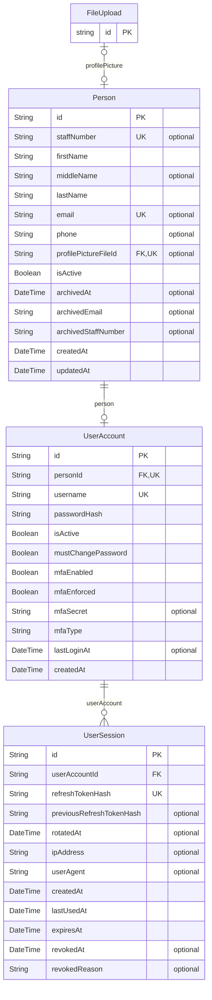
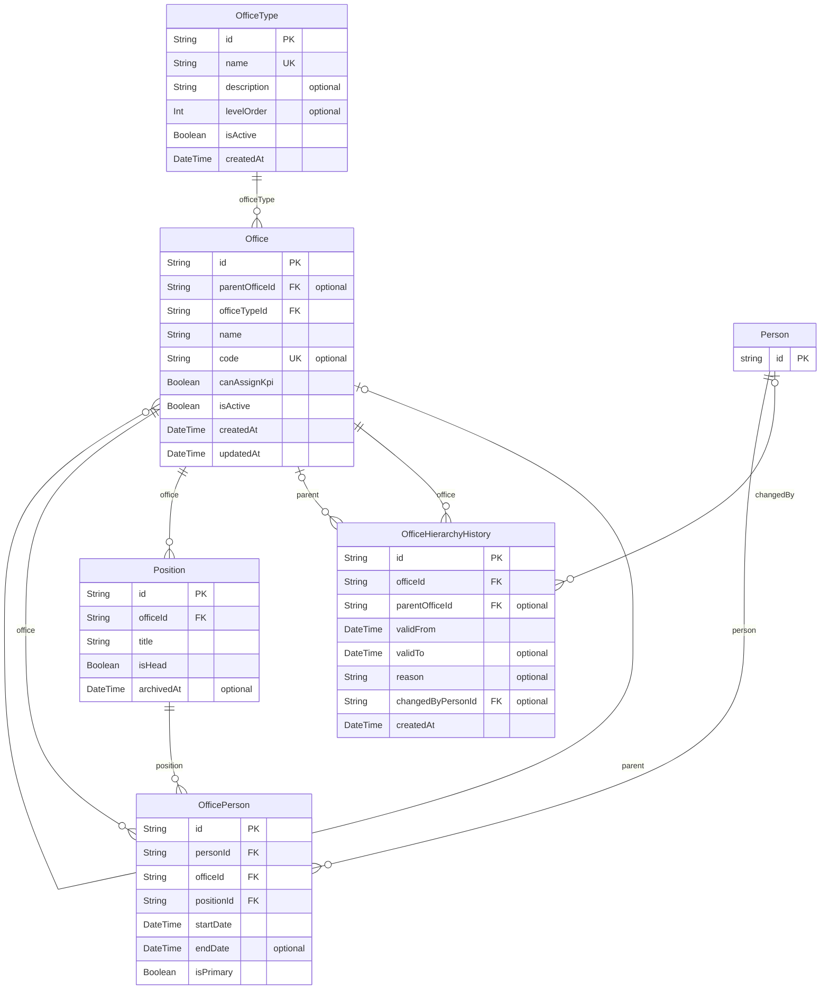
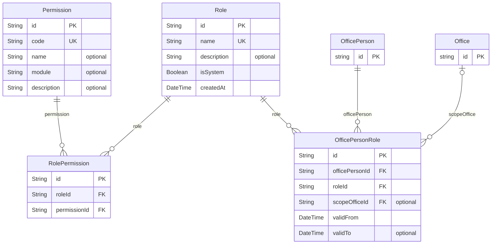
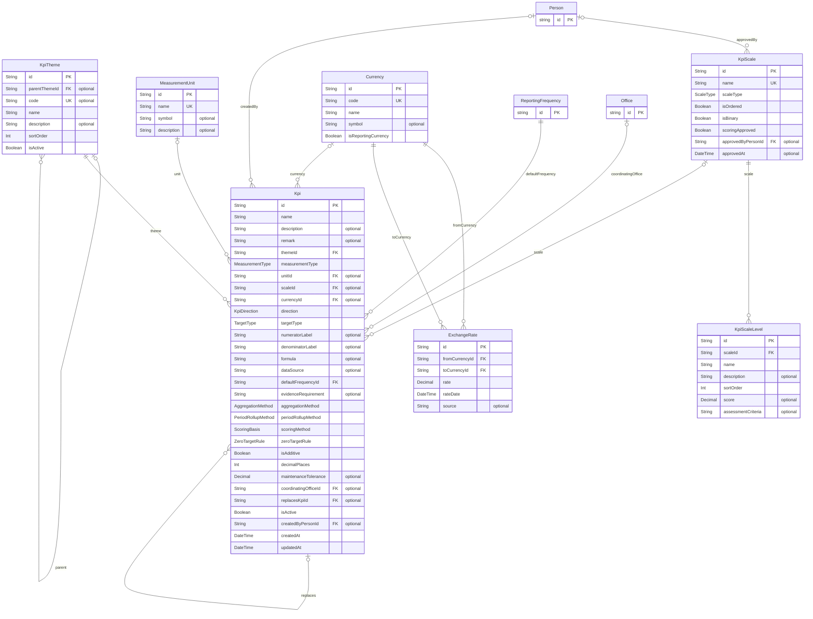
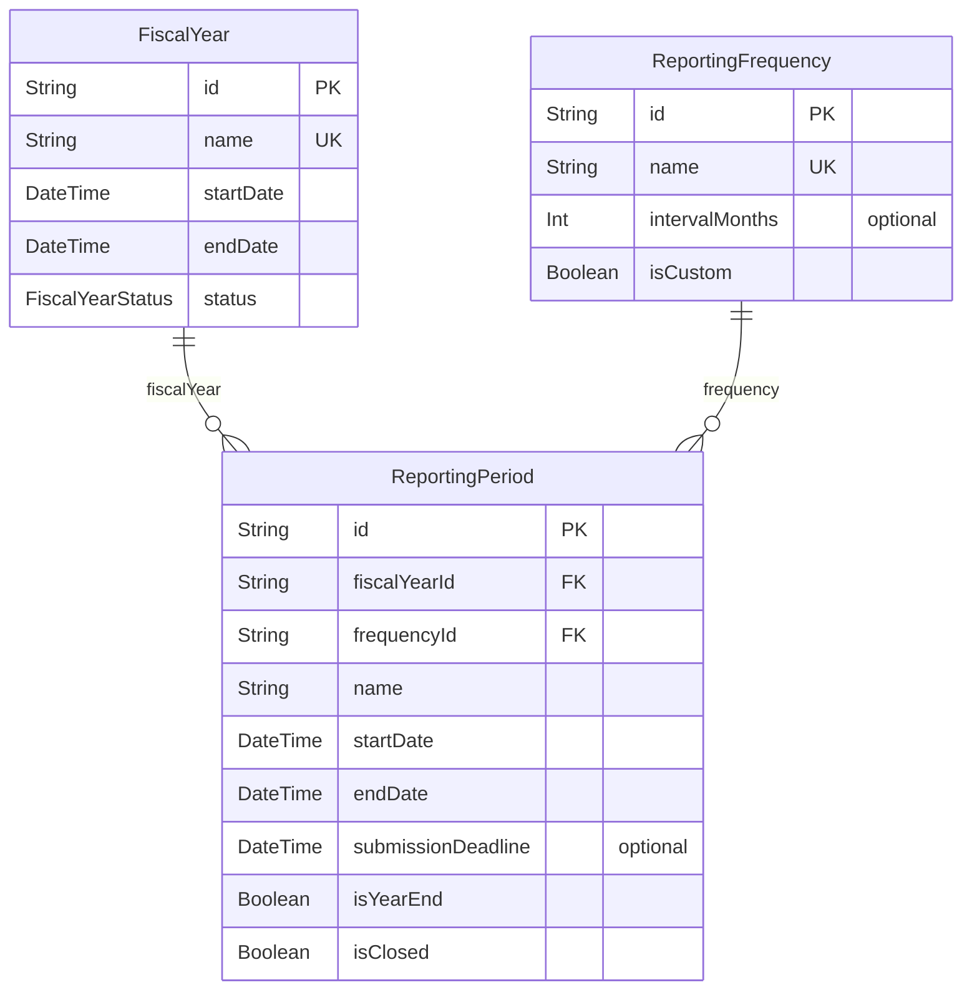
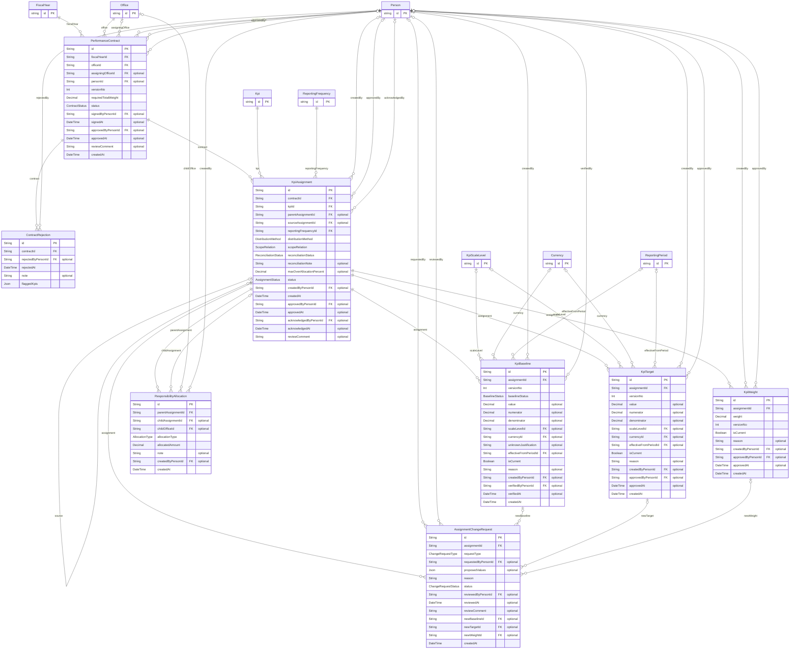
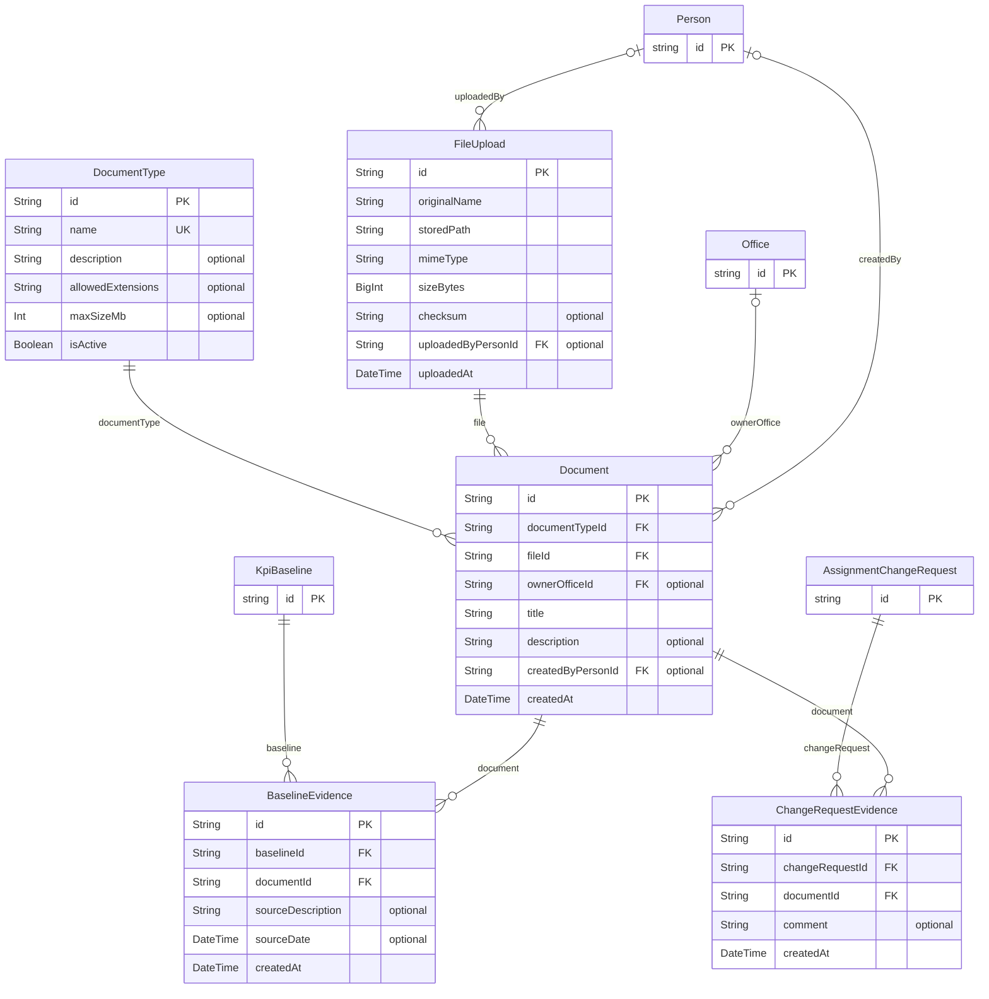
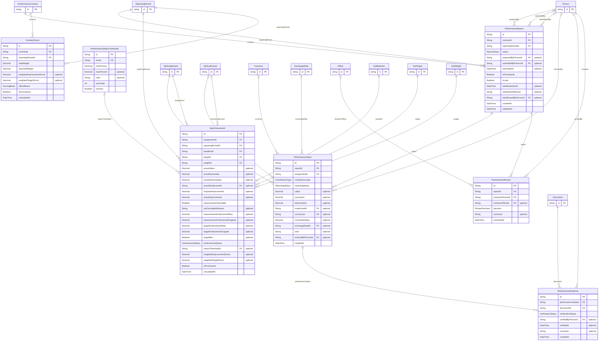
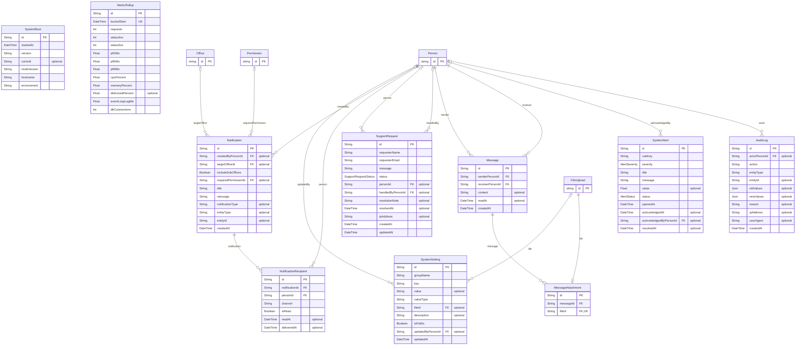

# Entity Relationship Diagram - AMU-KPI-Monitoring-System

Generated from [Backend/prisma/schema.prisma](../Backend/prisma/schema.prisma) (52 models, 27 enums, PostgreSQL).
The diagrams are Mermaid `erDiagram` code: they render in GitHub, in VS Code with a Mermaid preview extension, and at https://mermaid.live.

## How to read it

- `PK` primary key, `FK` foreign key, `UK` unique column. A column marked "optional" can be empty.
- `||` exactly one, `|o` zero or one, `o{` zero or many, `o|` zero or one (a one-to-one link).
- The text on a line is the relation field in the schema, for example `Office ||--o{ Office : "parent"` reads "an office has many child offices".
- Names are the Prisma model names. The real table names are in `@@map` in the schema. Columns that point to another table by a relation list are not repeated as columns.
- Columns typed `X_list` are arrays. Enum columns show the enum's name as their type.

## Whole system (relationships only)

```mermaid
erDiagram
    FileUpload
    Person
    UserAccount
    UserSession
    Office
    OfficeType
    OfficeHierarchyHistory
    Position
    OfficePerson
    Role
    RolePermission
    Permission
    OfficePersonRole
    KpiTheme
    KpiScale
    KpiScaleLevel
    Currency
    ExchangeRate
    Kpi
    MeasurementUnit
    ReportingFrequency
    FiscalYear
    ReportingPeriod
    PerformanceContract
    ContractRejection
    KpiAssignment
    KpiWeight
    KpiBaseline
    KpiTarget
    ResponsibilityAllocation
    AssignmentChangeRequest
    DocumentType
    Document
    BaselineEvidence
    ChangeRequestEvidence
    PerformanceReport
    PerformanceValue
    PerformanceEvidence
    PerformanceReview
    KpiAchievement
    PerformanceStatusThreshold
    ContractScore
    SystemSetting
    Notification
    NotificationRecipient
    SupportRequest
    Message
    MessageAttachment
    SystemAlert
    AuditLog
    FileUpload |o--o| Person : "profilePicture"
    Person ||--o| UserAccount : "person"
    UserAccount ||--o{ UserSession : "userAccount"
    Office |o--o{ Office : "parent"
    OfficeType ||--o{ Office : "officeType"
    Office ||--o{ OfficeHierarchyHistory : "office"
    Office |o--o{ OfficeHierarchyHistory : "parent"
    Person |o--o{ OfficeHierarchyHistory : "changedBy"
    Office ||--o{ Position : "office"
    Person ||--o{ OfficePerson : "person"
    Office ||--o{ OfficePerson : "office"
    Position ||--o{ OfficePerson : "position"
    Role ||--o{ RolePermission : "role"
    Permission ||--o{ RolePermission : "permission"
    OfficePerson ||--o{ OfficePersonRole : "officePerson"
    Role ||--o{ OfficePersonRole : "role"
    Office |o--o{ OfficePersonRole : "scopeOffice"
    KpiTheme |o--o{ KpiTheme : "parent"
    Person |o--o{ KpiScale : "approvedBy"
    KpiScale ||--o{ KpiScaleLevel : "scale"
    Currency ||--o{ ExchangeRate : "fromCurrency"
    Currency ||--o{ ExchangeRate : "toCurrency"
    KpiTheme ||--o{ Kpi : "theme"
    MeasurementUnit |o--o{ Kpi : "unit"
    KpiScale |o--o{ Kpi : "scale"
    Currency |o--o{ Kpi : "currency"
    ReportingFrequency ||--o{ Kpi : "defaultFrequency"
    Office |o--o{ Kpi : "coordinatingOffice"
    Kpi |o--o{ Kpi : "replaces"
    Person |o--o{ Kpi : "createdBy"
    FiscalYear ||--o{ ReportingPeriod : "fiscalYear"
    ReportingFrequency ||--o{ ReportingPeriod : "frequency"
    FiscalYear ||--o{ PerformanceContract : "fiscalYear"
    Office ||--o{ PerformanceContract : "office"
    Office |o--o{ PerformanceContract : "assigningOffice"
    Person |o--o{ PerformanceContract : "person"
    Person |o--o{ PerformanceContract : "signedBy"
    Person |o--o{ PerformanceContract : "approvedBy"
    PerformanceContract ||--o{ ContractRejection : "contract"
    Person |o--o{ ContractRejection : "rejectedBy"
    PerformanceContract ||--o{ KpiAssignment : "contract"
    Kpi ||--o{ KpiAssignment : "kpi"
    KpiAssignment |o--o{ KpiAssignment : "parent"
    KpiAssignment |o--o{ KpiAssignment : "source"
    ReportingFrequency ||--o{ KpiAssignment : "reportingFrequency"
    Person |o--o{ KpiAssignment : "createdBy"
    Person |o--o{ KpiAssignment : "approvedBy"
    Person |o--o{ KpiAssignment : "acknowledgedBy"
    KpiAssignment ||--o{ KpiWeight : "assignment"
    Person |o--o{ KpiWeight : "createdBy"
    Person |o--o{ KpiWeight : "approvedBy"
    KpiAssignment ||--o{ KpiBaseline : "assignment"
    KpiScaleLevel |o--o{ KpiBaseline : "scaleLevel"
    Currency |o--o{ KpiBaseline : "currency"
    ReportingPeriod |o--o{ KpiBaseline : "effectiveFromPeriod"
    Person |o--o{ KpiBaseline : "createdBy"
    Person |o--o{ KpiBaseline : "verifiedBy"
    KpiAssignment ||--o{ KpiTarget : "assignment"
    KpiScaleLevel |o--o{ KpiTarget : "scaleLevel"
    Currency |o--o{ KpiTarget : "currency"
    ReportingPeriod |o--o{ KpiTarget : "effectiveFromPeriod"
    Person |o--o{ KpiTarget : "createdBy"
    Person |o--o{ KpiTarget : "approvedBy"
    KpiAssignment ||--o{ ResponsibilityAllocation : "parentAssignment"
    KpiAssignment |o--o{ ResponsibilityAllocation : "childAssignment"
    Office |o--o{ ResponsibilityAllocation : "childOffice"
    Person |o--o{ ResponsibilityAllocation : "createdBy"
    KpiAssignment ||--o{ AssignmentChangeRequest : "assignment"
    Person |o--o{ AssignmentChangeRequest : "requestedBy"
    Person |o--o{ AssignmentChangeRequest : "reviewedBy"
    KpiBaseline |o--o{ AssignmentChangeRequest : "newBaseline"
    KpiTarget |o--o{ AssignmentChangeRequest : "newTarget"
    KpiWeight |o--o{ AssignmentChangeRequest : "newWeight"
    Person |o--o{ FileUpload : "uploadedBy"
    DocumentType ||--o{ Document : "documentType"
    FileUpload ||--o{ Document : "file"
    Office |o--o{ Document : "ownerOffice"
    Person |o--o{ Document : "createdBy"
    KpiBaseline ||--o{ BaselineEvidence : "baseline"
    Document ||--o{ BaselineEvidence : "document"
    AssignmentChangeRequest ||--o{ ChangeRequestEvidence : "changeRequest"
    Document ||--o{ ChangeRequestEvidence : "document"
    PerformanceContract ||--o{ PerformanceReport : "contract"
    ReportingPeriod ||--o{ PerformanceReport : "reportingPeriod"
    Person |o--o{ PerformanceReport : "preparedBy"
    Person |o--o{ PerformanceReport : "submittedBy"
    Person |o--o{ PerformanceReport : "lateAllowedBy"
    PerformanceReport ||--o{ PerformanceValue : "report"
    KpiAssignment ||--o{ PerformanceValue : "assignment"
    KpiScaleLevel |o--o{ PerformanceValue : "scaleLevel"
    Currency |o--o{ PerformanceValue : "currency"
    ExchangeRate |o--o{ PerformanceValue : "exchangeRate"
    Person |o--o{ PerformanceValue : "enteredBy"
    PerformanceValue ||--o{ PerformanceEvidence : "performanceValue"
    Document ||--o{ PerformanceEvidence : "document"
    Person |o--o{ PerformanceEvidence : "verifiedBy"
    PerformanceReport ||--o{ PerformanceReview : "report"
    Person ||--o{ PerformanceReview : "reviewer"
    Office |o--o{ PerformanceReview : "reviewerOffice"
    KpiAssignment ||--o{ KpiAchievement : "assignment"
    ReportingPeriod ||--o{ KpiAchievement : "reportingPeriod"
    KpiBaseline ||--o{ KpiAchievement : "baseline"
    KpiTarget ||--o{ KpiAchievement : "target"
    KpiWeight ||--o{ KpiAchievement : "weight"
    KpiScaleLevel |o--o{ KpiAchievement : "actualScaleLevel"
    PerformanceStatusThreshold |o--o{ KpiAchievement : "statusThreshold"
    PerformanceContract ||--o{ ContractScore : "contract"
    ReportingPeriod ||--o{ ContractScore : "reportingPeriod"
    FileUpload |o--o{ SystemSetting : "file"
    Person |o--o{ SystemSetting : "updatedBy"
    Person |o--o{ Notification : "createdBy"
    Office |o--o{ Notification : "targetOffice"
    Permission |o--o{ Notification : "requiredPermission"
    Notification ||--o{ NotificationRecipient : "notification"
    Person ||--o{ NotificationRecipient : "person"
    Person |o--o{ SupportRequest : "person"
    Person |o--o{ SupportRequest : "handledBy"
    Person ||--o{ Message : "sender"
    Person ||--o{ Message : "receiver"
    Message ||--o{ MessageAttachment : "message"
    FileUpload ||--o| MessageAttachment : "file"
    Person |o--o{ SystemAlert : "acknowledgedBy"
    Person |o--o{ AuditLog : "actor"
```

## Identity

Tables: `Person`, `UserAccount`, `UserSession`.

Defined in another part and shown only as a stub (id only), because a table here points to it: `FileUpload`.

## Office hierarchy

Tables: `OfficeType`, `Office`, `OfficeHierarchyHistory`, `Position`, `OfficePerson`.

Defined in another part and shown only as a stub (id only), because a table here points to it: `Person`.

## Dynamic roles

Tables: `Role`, `Permission`, `RolePermission`, `OfficePersonRole`.

Defined in another part and shown only as a stub (id only), because a table here points to it: `OfficePerson`, `Office`.

## KPI definition

Tables: `KpiTheme`, `MeasurementUnit`, `KpiScale`, `KpiScaleLevel`, `Currency`, `ExchangeRate`, `Kpi`.

Defined in another part and shown only as a stub (id only), because a table here points to it: `Person`, `ReportingFrequency`, `Office`.

## Periods

Tables: `ReportingFrequency`, `FiscalYear`, `ReportingPeriod`.

## Contracts and cascading

Tables: `PerformanceContract`, `ContractRejection`, `KpiAssignment`, `KpiWeight`, `KpiBaseline`, `KpiTarget`, `ResponsibilityAllocation`, `AssignmentChangeRequest`.

Defined in another part and shown only as a stub (id only), because a table here points to it: `FiscalYear`, `Office`, `Person`, `Kpi`, `ReportingFrequency`, `KpiScaleLevel`, `Currency`, `ReportingPeriod`.

## Files and documents

Tables: `FileUpload`, `DocumentType`, `Document`, `BaselineEvidence`, `ChangeRequestEvidence`.

Defined in another part and shown only as a stub (id only), because a table here points to it: `Person`, `Office`, `KpiBaseline`, `AssignmentChangeRequest`.

## Reporting and evaluation

Tables: `PerformanceReport`, `PerformanceValue`, `PerformanceEvidence`, `PerformanceReview`, `PerformanceStatusThreshold`, `KpiAchievement`, `ContractScore`.

Defined in another part and shown only as a stub (id only), because a table here points to it: `PerformanceContract`, `ReportingPeriod`, `Person`, `KpiAssignment`, `KpiScaleLevel`, `Currency`, `ExchangeRate`, `Document`, `Office`, `KpiBaseline`, `KpiTarget`, `KpiWeight`.

## System

Tables: `SystemSetting`, `Notification`, `NotificationRecipient`, `SupportRequest`, `Message`, `MessageAttachment`, `SystemBoot`, `SystemAlert`, `MetricRollup`, `AuditLog`.

Defined in another part and shown only as a stub (id only), because a table here points to it: `FileUpload`, `Person`, `Office`, `Permission`.

