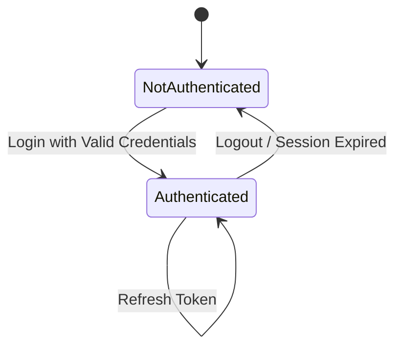
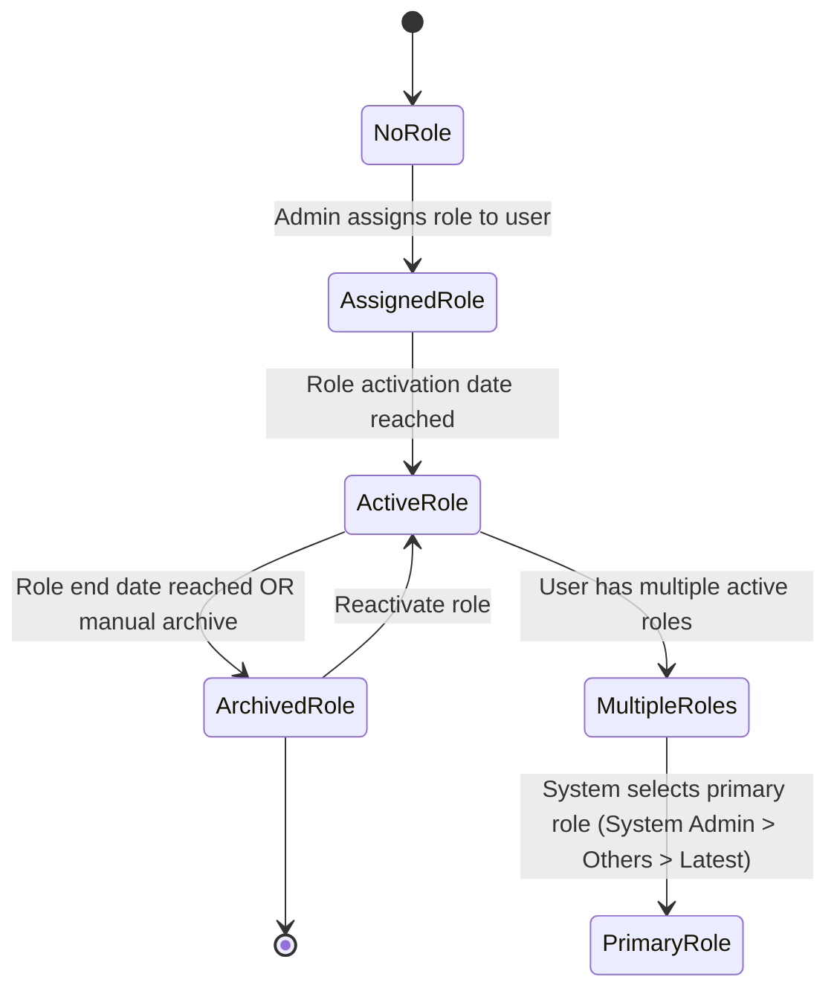
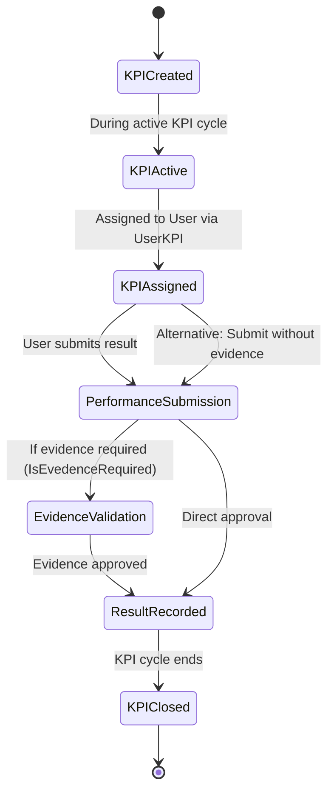
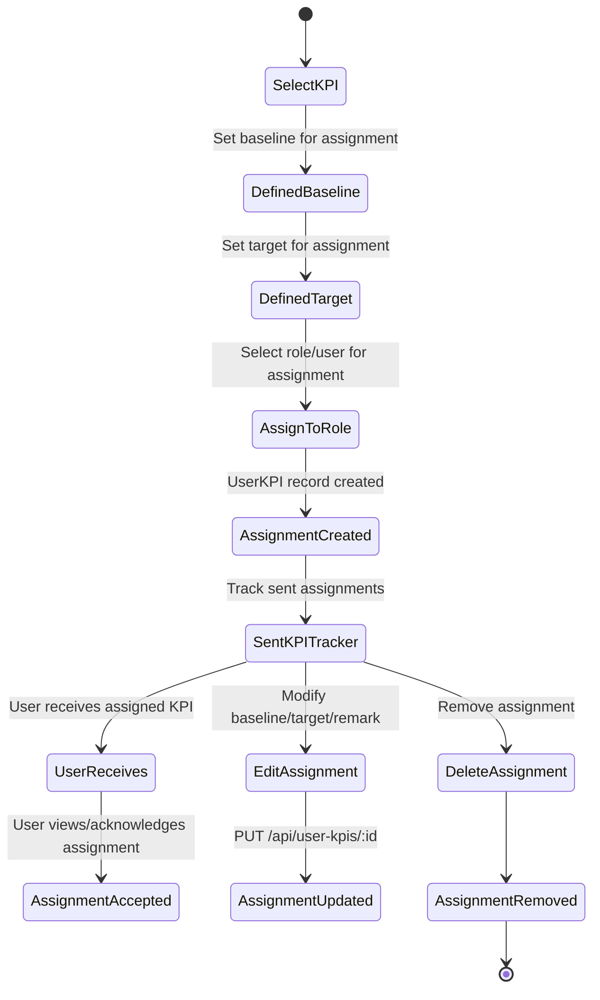
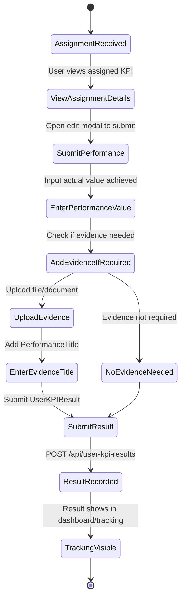
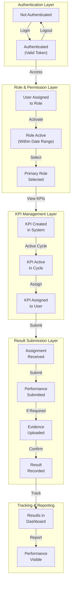

# AMU-KPI-Monitoring-System State Chart

## System Overview

This document outlines the key states and transitions in the AMU-KPI-Monitoring-System, focusing on the important business processes and user workflows.

---

## 1. Authentication & Session State



### Key Actions:

- **NotAuthenticated**: User at login page, no valid token
- **Authenticated**: Valid JWT token, user logged in with assigned role(s)
- **Transitions**: Login (POST /api/auth/login) → Refresh → Logout

---

## 2. User Role & Permission System



### Key Entities:

- **Role**: RoleName, RoleCategory, ParentRole (hierarchy)
- **UserRole**: Links User to Role with IsArchived, ToDate
- **RoleCategory**: Categorizes roles (Admin, Faculty, Staff, etc.)
- **Permissions**: Derived from role and RoleCategory

---

## 3. KPI Lifecycle



### Key Entities:

- **KPI**: KPICode, KPIName, Baseline, Target, IsEvedenceRequired
- **KPIType**: Type hierarchy (Parent/Child KPIs)
- **Unit**: Measurement unit for KPI
- **UserKPI**: Assignment of KPI to user with baseline/target/remarks
- **UserKPIResult**: Performance results with optional EvidenceURL, PerformanceTitle

### Key Fields:

- `KPI.IsEvedenceRequired`: Flag for whether evidence must be submitted
- `UserKPIResult.EvidenceURL`: URL to evidence document/file
- `UserKPIResult.PerformanceTitle`: Title of performance submission

---

## 4. KPI Allocation & Assignment Flow



### Key Operations:

- **Create Assignment**: POST /api/user-kpis (requires `create_kpi_allocation`)
- **Edit Assignment**: PUT /api/user-kpis/:id (requires `create_kpi_allocation` or `edit_kpi_allocation`)
- **Delete Assignment**: DELETE /api/user-kpis/:id (requires `create_kpi_allocation` or `delete_kpi_allocation`)
- **Batch Assignment**: Uses `AssignmentBatchId` (UUID) to group related assignments

---

## 5. Performance Result Submission & Tracking



### Key Fields in UserKPIResult:

- `UserId`: User who submitted
- `UserKPIId`: Reference to assignment
- `KPIId`: Reference to KPI
- `PerformanceValue`: Actual value achieved
- `EvidenceURL`: Document/file link (optional)
- `PerformanceTitle`: Title of submission
- `CreatedAt`: Submission timestamp

---

## 6. Complete System State Machine



---

## 7. Key State Transitions & Permissions

| Transition         | Required Permission        | Source State          | Target State          |
| ------------------ | -------------------------- | --------------------- | --------------------- |
| User Login         | -                          | Not Authenticated     | Authenticated         |
| Assign KPI         | `create_kpi_allocation`    | KPI Active            | KPI Assigned          |
| Edit Assignment    | `edit_kpi_allocation`      | Assignment Created    | Assignment Updated    |
| Delete Assignment  | `delete_kpi_allocation`    | Assignment Created    | Assignment Removed    |
| Submit Performance | - (Assigned User)          | Assignment Received   | Performance Submitted |
| Upload Evidence    | - (Assigned User)          | Performance Submitted | Evidence Uploaded     |
| View Results       | `view_performance_results` | Result Recorded       | Tracking Visible      |
| Archive Role       | `manage_user_roles`        | Active Role           | Archived Role         |

---

## 8. Data Flow Summary

```
User (Authentication)
    ↓
UserRole (Authorization)
    ↓
Role + Permissions (Access Control)
    ↓
KPI (System Resources)
    ↓
UserKPI (Assignment/Allocation)
    ↓
UserKPIResult (Performance Tracking)
    ↓
KPIDocument + OfficeReportSubmission (Evidence & Reporting)
```

---

## 9. Critical State Conditions

### Active UserRole Conditions:

- `IsArchived = false`
- `ToDate IS NULL` OR `ToDate >= TODAY`

### Active KPI Cycle:

- KPI must be associated with current cycle
- Assignments created during active cycle window

### Valid Assignment:

- `UserKPI` record exists
- User has active role matching assignment role
- KPI is active and not archived

### Complete Performance Result:

- `PerformanceValue` recorded
- If `KPI.IsEvedenceRequired = true`, then `UserKPIResult.EvidenceURL` must exist
- `PerformanceTitle` provided if evidence uploaded

---

## 10. Key Entities & Relationships

```
User (1) ──→ (M) UserRole (1) ──→ (1) Role (1) ──→ (1) RoleCategory
     ↓                                    ↓
     └────────→ (M) UserKPI (1) ──→ (1) KPI (1) ──→ (1) KPIType
     │               ↓                    ↓
     │               ├─→ (M) UserKPIResult    └──→ (1) Unit
     │               └─→ (1) UserKPI
     │
     └────────→ (M) UserKPIResult
     │
     └────────→ (M) KPIDocument (1) ──→ (1) KPI
     │
     └────────→ (1) OfficeReportSubmission
```

---

## Notes

- **Session Management**: Uses JWT tokens; cleared on logout
- **Role Hierarchy**: Roles can have parent-child relationships
- **KPI Hierarchy**: KPITypes support parent-child relationships
- **Assignment Batching**: Multiple assignments can be grouped via `AssignmentBatchId`
- **Archiving**: Soft deletes using `IsArchived` flag
- **Audit Trail**: `CreatedBy`, `CreatedAt`, `UpdatedAt` tracked on key entities
